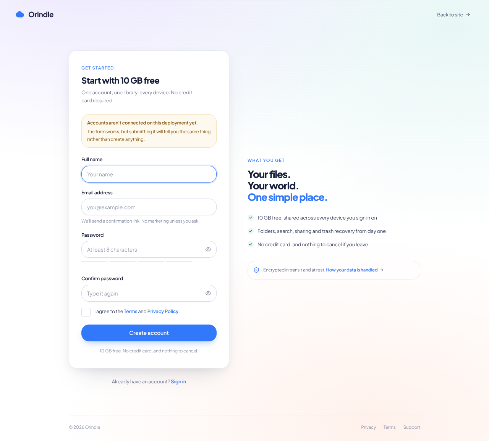
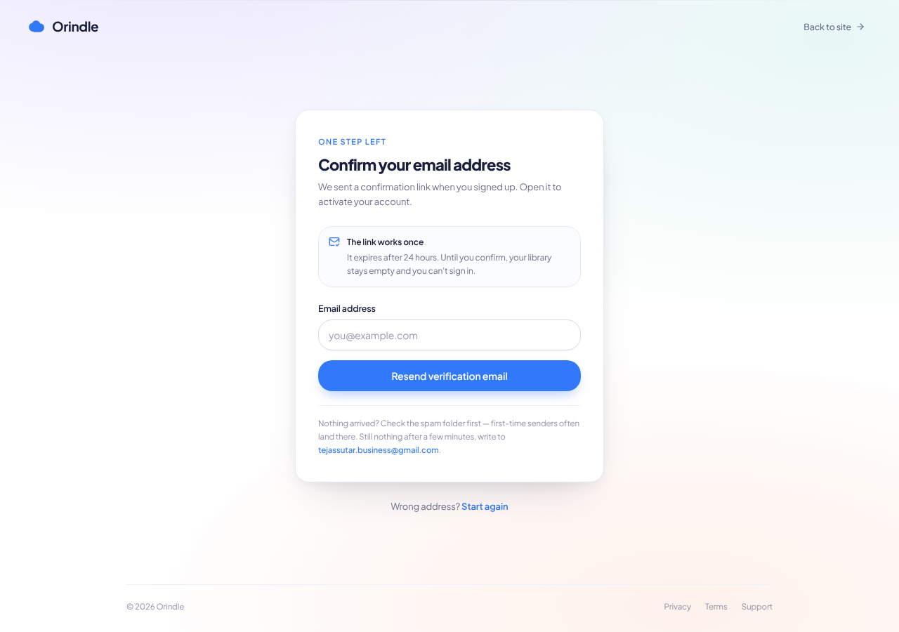
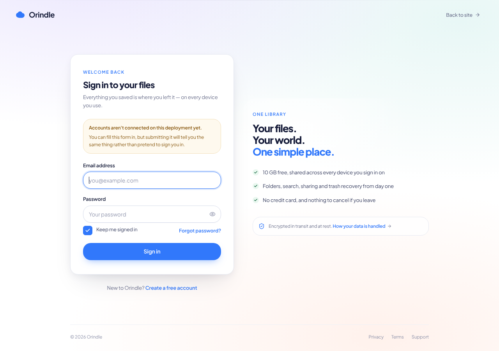

# Orindle — External Services Setup & Deployment Guide

> **Last verified against official provider documentation & latest Orindle source code:** **16 November 2026**
> **Repository branch inspected:** `sutarorg/orindlecom` (`main` @ `f7923b0`)
> **Target stack:** Next.js `16.4.6` (React `19.3.1`) · Vercel · GitHub · Supabase (Postgres + Auth + RLS) · Google Auth Platform (OAuth) · Cloudflare R2 · Cloudflare Turnstile · Razorpay · Resend

---

## Important Safety & Honesty Notice

- **Nothing in this guide has been deployed or activated automatically.** As of **16 November 2026**, no live external service (Supabase, Google Cloud, Cloudflare R2/Turnstile, Razorpay, Resend, Vercel, DNS, or Search Console) has been configured or verified by this repository checkout.
- **Never deploy to production, change live DNS, or switch Razorpay to Live Mode without explicit approval and completed verification on a Preview deployment first.**
- **Never paste real secrets** into `.env.example`, frontend code, `NEXT_PUBLIC_*` variables, Git commits, screenshots, chat logs, or documentation.
- **Keep Development/Preview and Production completely isolated.** A Preview deployment connected to a Production database or live payment keys can destroy customer files or take real money by mistake.

---

## Table of Contents

1. [Architecture & Prerequisites Overview](#1-architecture--prerequisites-overview)
2. [Complete Environment Variable Reference (Scanned from Source Code)](#2-complete-environment-variable-reference-scanned-from-source-code)
3. [Test vs. Production Credentials Separation & Secret Hygiene](#3-test-vs-production-credentials-separation--secret-hygiene)
4. [Click-by-Click External Service Configuration](#4-click-by-click-external-service-configuration)
   - [4.1 GitHub](#41-github)
   - [4.2 Supabase (Database, Migrations, Auth, Email/SMTP, OAuth, MFA)](#42-supabase-database-migrations-auth-emailsmtp-oauth-mfa)
   - [4.3 Google Cloud Console — Google Auth Platform (Google OAuth)](#43-google-cloud-console--google-auth-platform-google-oauth)
   - [4.4 Cloudflare R2 (Private Object Storage & CORS)](#44-cloudflare-r2-private-object-storage--cors)
   - [4.5 Cloudflare Turnstile (Signup Bot Protection)](#45-cloudflare-turnstile-signup-bot-protection)
   - [4.6 Razorpay (Payments, Webhooks & Capability Approvals)](#46-razorpay-payments-webhooks--capability-approvals)
   - [4.7 Resend (Transactional Email, Domain Verification, SPF/DKIM/DMARC)](#47-resend-transactional-email-domain-verification-spfdkimdmarc)
   - [4.8 Vercel (Hosting, Environment Variables & Cron Jobs)](#48-vercel-hosting-environment-variables--cron-jobs)
   - [4.9 Domain Registrar & DNS Configuration (`orindle.com`)](#49-domain-registrar--dns-configuration-orindlecom)
   - [4.10 Google Analytics 4 & Google Search Console (Implementation Status)](#410-google-analytics-4--google-search-console-implementation-status)
5. [Platform Administrator (Admin Login) Setup](#5-platform-administrator-admin-login-setup)
6. [Ordered Step-by-Step Local Setup & Production Deployment Playbook](#6-ordered-step-by-step-local-setup--production-deployment-playbook)
7. [Final Checklists & Status Tracker](#7-final-checklists--status-tracker)
8. [Common Errors & Exact Fixes](#8-common-errors--exact-fixes)
9. [Official Provider Documentation References (Verified 16 Nov 2026)](#9-official-provider-documentation-references-verified-16-nov-2026)

---

## 1. Architecture & Prerequisites Overview

Before clicking any dashboards, understand what each external service does inside Orindle:

| Service | Role in Orindle | Required for Launch? |
| --- | --- | --- |
| **GitHub** | Hosts source code and triggers automatic Vercel Preview & Production deployments. | **Yes** |
| **Supabase** | PostgreSQL database (19 migrations, RLS across all tables), user authentication (email/password, Google OAuth, TOTP MFA), rate limiting, and audit logs. | **Yes** |
| **Google Cloud (Google Auth Platform)** | Provides OAuth 2.0 Client ID & Secret for **Continue with Google** sign-in. | **Optional** (button stays hidden until enabled) |
| **Cloudflare R2** | S3-compatible private file storage using short-lived presigned upload/download URLs (`u/<userId>/...`, `o/<orgId>/...`). | **Yes** (for file storage) |
| **Cloudflare Turnstile** | Bot protection on `/signup` with server-side single-use token verification. | **Recommended** (requires CSP update before enabling — see §4.5) |
| **Resend** | Transactional emails (contact form notifications, admin support replies, expiry warnings, deletion notices) AND recommended Custom SMTP relay for Supabase Auth emails. | **Yes** (verified custom domain required for real users) |
| **Razorpay** | Paid plan checkout (INR / USD monthly plans), signature verification, and webhooks. | **When selling paid plans** (Test Mode first; Live Mode only after KYC + capability approvals) |
| **Vercel** | Runs the Next.js 16 application, serves HTTPS custom domain, and invokes all 9 scheduled cron jobs in `vercel.json`. | **Yes** (**Pro plan** required for sub-daily cron schedules — see §4.8) |
| **Domain Registrar / DNS** | Routes `orindle.com` & `www.orindle.com` to Vercel, verifies Resend SPF/DKIM/DMARC, and verifies Google Search Console ownership. | **Yes** (for production domain) |
| **Google Search Console** | Monitors indexing of Orindle's 26 public URLs (`/sitemap.xml` & `/robots.txt`). | **Recommended for SEO** (in-app `/admin/analytics` Search Console API is not wired yet) |
| **Google Analytics 4 (GA4)** | Optional future reporting adapter in `/admin/analytics`. | **No — NOT active in current code** (see §4.10) |

### Local Machine Prerequisites

- **Node.js 22 LTS** (verified against Node 22; `README.md` specifies Node 20+ minimum) and `npm`
- **Git** (`git --version`)
- **OpenSSL** (or Node `crypto`) to generate strong random secrets (`CRON_SECRET`, `ABUSE_HASH_SALT`)
- **Supabase CLI** (optional, recommended for applying migrations cleanly: `npm install -g supabase` or `npx supabase`)

> **Good to know for beginners:** Orindle is designed to **degrade honestly**. Even with an empty `.env.local`, the entire public website renders cleanly, `/api/health` reports each subsystem as `"missing"`, and every feature explains plainly that it is not connected yet rather than crashing or pretending to succeed.

---

## 2. Complete Environment Variable Reference (Scanned from Source Code)

Every variable below was verified directly by scanning `src/`, `next.config.ts`, and `.env.example` (38 variables in `.env.example` + 1 automatic runtime variable `NODE_ENV` = **39 total**). **No variable names have been invented.**

### Quick Legend

- **Public (`NEXT_PUBLIC_*`)**: Safe to expose in the browser bundle. In Vercel, set Type to **Config**.
- **Secret (no `NEXT_PUBLIC_` prefix)**: Server-only. Never ship to the browser, never commit to Git. In Vercel, set Type to **Secret** for credentials/keys and **Config** for non-sensitive flags/numbers.
- **Local file**: `.env.local` in the repository root (already git-ignored by `.gitignore`).
- **Vercel location**: `https://vercel.com/dashboard` → Select your Orindle project → **Settings** (top/left menu) → **Environment Variables**.

---

### 2.1 Site Configuration (1 Variable)

| Variable | Visibility / Vercel Type | Service / Source | Where to Find / Generate | Local (`.env.local`) | Vercel Environments |
| --- | --- | --- | --- | --- | --- |
| `NEXT_PUBLIC_SITE_URL` | **Public** · Vercel **Config** | Your deployment URL | You define this yourself. Used by `src/config/site.ts` (metadata, `/sitemap.xml`, `/robots.txt`) and `src/lib/auth/redirect.ts` (fallback origin). | `http://localhost:3000` | **Production:** `https://orindle.com`<br>**Preview:** Your preview URL (or leave unset so `resolveOrigin` uses `x-forwarded-host`)<br>**Development:** `http://localhost:3000` |

---

### 2.2 Supabase — Database & Authentication (4 Variables)

> **Important November 2026 Supabase Update:** Supabase is deprecating the legacy JWT-based `anon` and `service_role` keys by the end of 2026 in favor of **Publishable (`sb_publishable_...`)** and **Secret (`sb_secret_...`)** API keys. Orindle uses `@supabase/supabase-js` `^2.119.0` and `@supabase/ssr` `^0.12.7`, which support **both** formats. Keep the exact environment variable names Orindle's code reads (`NEXT_PUBLIC_SUPABASE_ANON_KEY` and `SUPABASE_SERVICE_ROLE_KEY`), and paste the new **Publishable** and **Secret** keys into them (recommended) — or the legacy keys if your project has not enabled the new keys yet.

#### `NEXT_PUBLIC_SUPABASE_URL`
- **Service:** Supabase
- **Dashboard URL:** `https://supabase.com/dashboard`
- **Exact Navigation:** Select your project → left sidebar **Project Settings** (gear icon at bottom) → **Data API** (or click the **Connect** button in the top bar → **App Frameworks** / **API**).
- **Where to copy from:** **Project URL** field (`https://<project-ref>.supabase.co`) → click the **Copy** icon.
- **Public or Secret:** **Public** (Vercel Type: **Config**).
- **Used in:** `src/lib/auth/supabase/server.ts`, `src/lib/supabase/service.ts`, `src/middleware.ts`, `next.config.ts` (CSP `connect-src`).
- **Where to configure:** `.env.local` (Dev project URL); Vercel **Preview** & **Development** (Dev project URL); Vercel **Production** (Production project URL).

#### `NEXT_PUBLIC_SUPABASE_ANON_KEY`
- **Service:** Supabase
- **Dashboard URL:** `https://supabase.com/dashboard`
- **Exact Navigation:** Select your project → **Project Settings** → **API Keys** → **Publishable and secret API keys** tab (or **Legacy anon, service_role API keys** tab for older projects).
- **Where to copy from:** Copy the **Publishable key** (`sb_publishable_...`) — or legacy **`anon` `public`** key (`eyJ...`) — via the **Copy** icon. If the tab says no publishable key exists yet, click **Create new API keys** first.
- **Public or Secret:** **Public** (RLS-scoped; safe in browser; Vercel Type: **Config**).
- **Used in:** `src/lib/auth/supabase/server.ts`, `src/middleware.ts`.
- **Where to configure:** `.env.local` (Dev key); Vercel **Preview** & **Development** (Dev key); Vercel **Production** (Production key).

#### `SUPABASE_SERVICE_ROLE_KEY`
- **Service:** Supabase
- **Dashboard URL:** `https://supabase.com/dashboard`
- **Exact Navigation:** Select your project → **Project Settings** → **API Keys** → **Publishable and secret API keys** tab (or **Legacy anon, service_role API keys** tab).
- **Where to copy from:** Click the **eye/reveal** icon next to the **Secret key** (`sb_secret_...`) — or legacy **`service_role` `secret`** key — then click **Copy**.
- **Public or Secret:** **SECRET — CRITICAL** (bypasses all Row Level Security! Vercel Type: **Secret**). Marked `server-only` in `src/lib/supabase/service.ts`. Never add a `NEXT_PUBLIC_` prefix.
- **Used in:** `src/lib/supabase/service.ts` (webhooks, cron jobs, rate limits, admin console after authorization, contact form ticket insert).
- **Where to configure:** `.env.local` (Dev secret key); Vercel **Preview** & **Development** (Dev secret key); Vercel **Production** (Production secret key).

#### `NEXT_PUBLIC_AUTH_PROVIDERS`
- **Service:** Orindle configuration flag (reflects Supabase Auth providers actually enabled)
- **Dashboard URL:** `https://supabase.com/dashboard` → **Authentication** → **Sign In / Providers** → **Google**
- **Value:** Leave empty (`""`) until Google OAuth is fully configured and tested. Set to `google` **only after** Google OAuth is turned ON in Supabase with valid Google Client ID & Secret. (Only `google` is supported in `src/lib/auth/supabase/server.ts`.)
- **Public or Secret:** **Public** (Vercel Type: **Config**).
- **Where to configure:** `.env.local`; Vercel **Preview** & **Production** (only after each respective Supabase project has Google OAuth configured).

---

### 2.3 Cloudflare R2 — Object Storage (6 Variables)

#### `R2_ACCOUNT_ID`
- **Service:** Cloudflare R2
- **Dashboard URL:** `https://dash.cloudflare.com/`
- **Exact Navigation:** Left sidebar **Storage & databases** → **R2 object storage** → **Overview** (or copy the 32-character hex ID from your dashboard URL `dash.cloudflare.com/<ACCOUNT_ID>/...`, or click the **Account details** sidebar on the R2 Overview page).
- **Where to copy from:** **Account ID** → **Click to copy**.
- **Public or Secret:** **Server-only config** (Vercel Type: **Config**). Read at build time by `next.config.ts` to add `https://<R2_ACCOUNT_ID>.r2.cloudflarestorage.com` to the CSP `connect-src` and `img-src` headers, and at runtime by `src/lib/r2/client.ts`.
- **Where to configure:** `.env.local`; Vercel **Development**, **Preview**, **Production**.

#### `R2_ACCESS_KEY_ID`
- **Service:** Cloudflare R2
- **Dashboard URL:** `https://dash.cloudflare.com/`
- **Exact Navigation:** **Storage & databases** → **R2 object storage** → **Overview** → under **Account Details / API Tokens**, click **Manage** (or **Manage R2 API Tokens**) → **Create Account API token** (or **Create User API token**) → Permissions: **Object Read & Write** → **Apply to specific buckets only** (pick your environment bucket) → **Create API Token**.
- **Where to copy from:** **Access Key ID** field on the one-time token confirmation screen → click **Copy**.
- **Public or Secret:** **SECRET** (Vercel Type: **Secret**).
- **Used in:** `src/lib/r2/client.ts`.
- **Where to configure:** `.env.local` (dev bucket token); Vercel **Preview** (dev bucket token); Vercel **Production** (prod bucket token).

#### `R2_SECRET_ACCESS_KEY`
- **Service:** Cloudflare R2
- **Dashboard URL:** Same one-time confirmation page as `R2_ACCESS_KEY_ID` above.
- **Exact Navigation:** Same flow as `R2_ACCESS_KEY_ID` above.
- **Where to copy from:** **Secret Access Key** field (shown **only once** at token creation; store immediately in your password manager).
- **Public or Secret:** **SECRET** (Vercel Type: **Secret**).
- **Used in:** `src/lib/r2/client.ts`.
- **Where to configure:** `.env.local` (dev token); Vercel **Preview** (dev token); Vercel **Production** (prod token).

#### `R2_BUCKET`
- **Service:** Cloudflare R2
- **Dashboard URL:** `https://dash.cloudflare.com/`
- **Exact Navigation:** **Storage & databases** → **R2 object storage** → **Overview** → **Create bucket**.
- **Value:** Exact lowercase bucket name you created — recommended: `orindle-dev` (for Local & Preview) and `orindle-prod` (for Production).
- **Public or Secret:** **Server-only config** (Vercel Type: **Config**).
- **Used in:** `src/lib/r2/client.ts`.
- **Where to configure:** `.env.local` (`orindle-dev`); Vercel **Preview** (`orindle-dev`); Vercel **Production** (`orindle-prod`).

#### `R2_ENDPOINT` *(Optional)*
- **Service:** Cloudflare R2
- **Dashboard URL:** `https://dash.cloudflare.com/`
- **Exact Navigation:** **Storage & databases** → **R2 object storage** → click your bucket → **Settings** → **General** → **S3 API**.
- **Value:** Leave **empty** to let `src/lib/r2/client.ts` automatically derive `https://<R2_ACCOUNT_ID>.r2.cloudflarestorage.com`. Set explicitly **only** if using a jurisdiction-specific endpoint (for example, EU: `https://<R2_ACCOUNT_ID>.eu.r2.cloudflarestorage.com`).
- **Public or Secret:** **Server-only config** (Vercel Type: **Config**).
- **Where to configure:** Optional in `.env.local` and Vercel environments.

#### `R2_PUBLIC_BASE_URL` *(Optional — `avatars/` prefix ONLY)*
- **Service:** Cloudflare R2
- **Dashboard URL:** `https://dash.cloudflare.com/`
- **Exact Navigation:** **Storage & databases** → **R2 object storage** → click bucket → **Settings** → **Public access** → **Custom Domains** → **Connect Domain**.
- **Value:** Base URL such as `https://assets.orindle.com` (leave empty to keep bucket 100% private). **Important:** `publicUrl()` in `src/lib/r2/client.ts` strictly throws an error for any object key that does not begin with `avatars/`. Private user files are **never** served via `R2_PUBLIC_BASE_URL`; they use 300-second presigned GET URLs.
- **Public or Secret:** **Server-only config** (also read by `next.config.ts` for CSP `img-src`/`connect-src`; Vercel Type: **Config**).
- **Where to configure:** Leave empty initially; configure only if serving public avatars via a dedicated custom domain.

---

### 2.4 Cloudflare Turnstile — Bot Protection (2 Variables)

#### `NEXT_PUBLIC_TURNSTILE_SITE_KEY` *(Optional)*
- **Service:** Cloudflare Turnstile
- **Dashboard URL:** `https://dash.cloudflare.com/?to=/:account/turnstile`
- **Exact Navigation:** Left sidebar **Turnstile** → **Add widget** → fill **Widget name**, **Hostname management**, **Widget mode** (`Managed`) → **Create**.
- **Where to copy from:** **Site Key** shown after creation (or later under **Turnstile** → click widget → **Settings**). For local testing, Cloudflare provides official dummy always-pass key `1x00000000000000000000AA`.
- **Public or Secret:** **Public** (Vercel Type: **Config**).
- **Used in:** `src/components/security/turnstile-widget.tsx`, `src/lib/security/turnstile.ts`.
- **Where to configure:** `.env.local` (dummy test key or dev widget key); Vercel **Preview** (dev/preview widget key); Vercel **Production** (production widget key restricted to `orindle.com` / `www.orindle.com`).
- **CRITICAL CSP Note:** See §4.5 before enabling! `next.config.ts` currently needs `https://challenges.cloudflare.com` added to `script-src` and `frame-src`.

#### `TURNSTILE_SECRET_KEY` *(Optional — required whenever `NEXT_PUBLIC_TURNSTILE_SITE_KEY` is set)*
- **Service:** Cloudflare Turnstile
- **Dashboard URL:** `https://dash.cloudflare.com/?to=/:account/turnstile`
- **Exact Navigation:** **Turnstile** → click widget → **Settings** → **Secret Key** → click **Copy**. (Official dummy test secret key: `1x0000000000000000000000000000000AA`.)
- **Public or Secret:** **SECRET** (Vercel Type: **Secret**).
- **Used in:** `src/lib/security/turnstile.ts` (`POST https://challenges.cloudflare.com/turnstile/v0/siteverify`).
- **Where to configure:** `.env.local` (dummy/dev secret); Vercel **Preview** (dev secret); Vercel **Production** (production secret).

---

### 2.5 Razorpay — Billing & Webhooks (5 Variables)

#### `NEXT_PUBLIC_RAZORPAY_KEY_ID`
- **Service:** Razorpay
- **Dashboard URL:** `https://dashboard.razorpay.com/`
- **Exact Navigation:** Switch top/left mode toggle to **Test Mode** (for Dev/Preview) or **Live Mode** (for Production **only after KYC approval**) → left sidebar **Account & Settings** → under **Website and app settings**, click **API Keys** → **Generate Key** (or **Regenerate Key**).
- **Where to copy from:** **Key ID** (`rzp_test_...` for Test Mode; `rzp_live_...` for Live Mode) in the pop-up or downloaded CSV.
- **Public or Secret:** **Public** (passed to Razorpay Checkout JS in browser; Vercel Type: **Config**).
- **Used in:** `src/domain/billing/razorpay.ts`, `src/app/api/health/route.ts`, `src/app/api/admin/settings/route.ts`, `src/app/admin/settings/page.tsx`, `src/lib/drive/supabase-repository.ts`.
- **Built-in Safety Guard:** `/api/health` and `/admin/settings` return `"mismatch"` if `rzp_live_...` is set outside `NODE_ENV=production` OR if `rzp_test_...` is set when `NODE_ENV=production`.
- **Where to configure:** `.env.local` (`rzp_test_...`); Vercel **Preview** (`rzp_test_...`); Vercel **Production** (**leave empty** until Razorpay KYC is approved, then set `rzp_live_...`).

#### `RAZORPAY_KEY_SECRET`
- **Service:** Razorpay
- **Dashboard URL:** `https://dashboard.razorpay.com/`
- **Exact Navigation:** Same **Account & Settings** → **API Keys** → **Generate Key** pop-up as above.
- **Where to copy from:** **Key Secret** (shown **only once** at generation time; download the key file and save it in a password manager, then delete the plaintext CSV from Downloads).
- **Public or Secret:** **SECRET** (Vercel Type: **Secret**).
- **Used in:** `src/domain/billing/razorpay.ts` (Basic Auth for `/v1/orders` + HMAC-SHA256 verification of `${orderId}|${paymentId}`).
- **Where to configure:** `.env.local` (Test secret); Vercel **Preview** (Test secret); Vercel **Production** (Live secret only after approval).

#### `RAZORPAY_WEBHOOK_SECRET`
- **Service:** Razorpay
- **Dashboard URL:** `https://dashboard.razorpay.com/`
- **Exact Navigation:** Select **Test Mode** or **Live Mode** → **Account & Settings** → under **Website and app settings**, click **Webhooks** → **+ Add New Webhook** → enter **Secret** (you generate a strong 32-character random secret yourself, e.g. `openssl rand -hex 24`, and paste the exact same string into Razorpay's **Secret** box and into `RAZORPAY_WEBHOOK_SECRET`).
- **Public or Secret:** **SECRET** (distinct from `RAZORPAY_KEY_SECRET`! Signs the raw webhook body in `X-Razorpay-Signature`; Vercel Type: **Secret**).
- **Used in:** `src/domain/billing/razorpay.ts`, `src/app/api/webhooks/razorpay/route.ts`.
- **Where to configure:** `.env.local` (for local webhook testing via tunnel); Vercel **Preview** (Test Mode webhook secret); Vercel **Production** (Live Mode webhook secret).

#### `RAZORPAY_RECURRING_ENABLED`
- **Service:** Orindle merchant capability switch (reflects Razorpay Subscriptions approval)
- **Dashboard URL:** `https://dashboard.razorpay.com/` → **Subscriptions** (under **Payment Products**) → **Settings**
- **Value:** `"false"` (default in `.env.example`) or `"true"`.
- **CRITICAL Code Behavior (`src/domain/billing/razorpay.ts`):** While this is `"false"`, `resolveApprovedPrice()` **refuses ALL paid plan checkouts** with `"Recurring subscriptions aren't available yet. Nothing was charged."` Set to `"true"` in **Test Mode** (for local/preview testing) and set to `"true"` in **Production ONLY after** Razorpay confirms recurring/subscription capability on your live merchant account.
- **Public or Secret:** **Server-only config** (Vercel Type: **Config**).
- **Where to configure:** `.env.local` (`true` when testing checkout in Test Mode, otherwise `false`); Vercel **Preview** (`true` for test checkout); Vercel **Production** (`false` until live approval).

#### `RAZORPAY_INTERNATIONAL_ENABLED`
- **Service:** Orindle merchant capability switch (reflects Razorpay International Payments approval)
- **Dashboard URL:** `https://dashboard.razorpay.com/` → **Account & Settings** → **Payment Methods** → **International Payments**
- **Value:** `"false"` (default) or `"true"`.
- **Code Behavior (`src/domain/billing/razorpay.ts`):** While `"false"`, all `USD` (non-INR) checkout orders are refused before reaching Razorpay. Set `"true"` in Production **only after** Razorpay approves International Payments on your live account.
- **Public or Secret:** **Server-only config** (Vercel Type: **Config**).
- **Where to configure:** `.env.local` / Vercel **Preview** / Vercel **Production** (`false` until approved).

---

### 2.6 Resend — Transactional Email (2 Variables)

#### `RESEND_API_KEY`
- **Service:** Resend
- **Dashboard URL:** `https://resend.com/api-keys`
- **Exact Navigation:** Left sidebar **API Keys** → **Create API Key** → enter Name (e.g., `orindle-production` or `orindle-dev`), Permission: **Sending access**, Domain: select your verified domain (or All domains while testing in sandbox) → **Add**.
- **Where to copy from:** One-time key dialog (`re_...`) → click **Copy**.
- **Public or Secret:** **SECRET** (Vercel Type: **Secret**).
- **Used in:** `src/lib/resend/client.ts`, `src/app/contact/actions.ts`, `src/app/api/health/route.ts`.
- **Where to configure:** `.env.local` (dev key); Vercel **Preview** (dev key); Vercel **Production** (production key scoped to verified domain).

#### `RESEND_FROM_ADDRESS`
- **Service:** Resend (must match a verified domain in Resend for production delivery)
- **Dashboard URL:** `https://resend.com/domains`
- **Value:**
  - Development / Sandbox (delivers **only** to your Resend account email; `/api/health` reports `"sandbox"`): `Orindle <onboarding@resend.dev>`
  - Production (after domain verification; `/api/health` reports `"configured"`): `Orindle <no-reply@mail.orindle.com>` (or `Orindle <no-reply@orindle.com>` if root domain is verified)
- **Public or Secret:** **Server-only config** (Vercel Type: **Config**).
- **Used in:** `src/lib/resend/client.ts`, `src/app/contact/actions.ts`, `src/app/api/health/route.ts`.
- **Where to configure:** `.env.local` (`Orindle <onboarding@resend.dev>`); Vercel **Preview** (sandbox or dev subdomain); Vercel **Production** (verified custom domain address).

---

### 2.7 Vercel Cron Jobs & Platform Markers (4 Variables)

#### `CRON_SECRET`
- **Service:** Self-generated secret read automatically by Vercel Cron
- **Dashboard URL:** `https://vercel.com/dashboard` → Project → **Settings** → **Environment Variables**
- **How to generate:** Run in your terminal:
  ```bash
  openssl rand -hex 32
  ```
  (Vercel recommends at least 16 random characters; 64 hex chars / 256 bits is strong.)
- **How it works:** When `CRON_SECRET` is set in Vercel Production, Vercel automatically attaches `Authorization: Bearer <CRON_SECRET>` to every scheduled `/api/cron/*` request. In Orindle (`src/lib/cron/auth.ts`), if `CRON_SECRET` is missing or wrong, every `/api/cron/*` endpoint returns **HTTP 404** (deliberately not 401, so routes are not discoverable).
- **Public or Secret:** **SECRET** (Vercel Type: **Secret**).
- **Used in:** `src/lib/cron/auth.ts`, `src/app/api/health/route.ts`, `src/app/api/admin/settings/route.ts`, `src/app/admin/settings/page.tsx`.
- **Where to configure:** `.env.local` (for local cron curl testing); Vercel **Preview** (different random string); Vercel **Production** (strong random string — remember to **redeploy** after adding or rotating it!).

#### `VERCEL` *(Auto-set by Vercel — DO NOT set manually)*
- **Service:** Vercel Runtime System Variable
- **Value:** Automatically set to `"1"` on all Vercel deployments. Leave empty in `.env.local`.
- **Used in:** `src/lib/security/ip.ts` (decides whether `x-forwarded-for` proxy headers can be trusted for anti-abuse rate limiting).

#### `CF_PAGES` *(Auto-set by Cloudflare Pages — DO NOT set manually)*
- **Service:** Cloudflare Pages Runtime System Variable
- **Value:** Leave empty in `.env.local` and Vercel. Read only if deployed on Cloudflare Pages (`src/lib/security/ip.ts`).

#### `NODE_ENV` *(Auto-set by Node.js / Next.js / Vercel — DO NOT set manually)*
- **Service:** Node.js / Next.js / Vercel Runtime
- **Value:** Automatically `"development"` under `npm run dev` and `"production"` under `next build` / Vercel Preview & Production.
- **Used in:** `src/app/api/health/route.ts`, `src/app/api/admin/settings/route.ts`, `src/app/admin/settings/page.tsx`, `src/lib/auth/redirect.ts`, `src/lib/auth/supabase/auth-cookie.ts`, `src/lib/security/device.ts`.
- **Important Preview Note:** Because Vercel sets `NODE_ENV=production` even on Preview builds, configuring `rzp_test_...` on a Vercel Preview deployment will show `razorpay: "mismatch"` on `/api/health` and `/admin/settings` — **this is expected on Preview** and does NOT block Test Mode checkout (`createOrder` and `verifyPaymentSignature` still run cleanly in Test Mode). On **Production**, `/api/health` must NEVER show `"mismatch"`.

---

### 2.8 Product Policy, Anti-Abuse & Malware Scanning (5 Variables)

| Variable | Visibility / Vercel Type | Source / How to Generate | Default / Recommended Value | Used In | Notes |
| --- | --- | --- | --- | --- | --- |
| `ABUSE_HASH_SALT` | **SECRET** · Vercel **Secret** | Generate locally: `openssl rand -hex 32` | Strong random 64-char hex string (unique per environment) | `src/lib/security/ip.ts`, `src/lib/security/signup-gate.ts` | Salts SHA-256 IP, device, and email hashes. Without it, logs a warning and IPv4 hashes become reversible. **Rotating it resets risk-engine history.** |
| `TRASH_RETENTION_DAYS` | **Server config** · Vercel **Config** | Product policy value | `30` (currently provisional until formally approved) | `src/lib/drive/types.ts`, `src/app/api/cron/trash-cleanup/route.ts` | Days before soft-deleted files in Trash are purged by `/api/cron/trash-cleanup`. |
| `RECOVERY_WINDOW_DAYS` | **Server config** · Vercel **Config** | Product policy value | `90` | `src/app/api/cron/subscription-sweep/route.ts` | Days after subscription expiry during which users receive warnings (days 0/7/30/60/83) before moving permanently to Free (files are **never** deleted). |
| `MALWARE_SCAN_ENABLED` | **Server config** · Vercel **Config** | Integration toggle | **`false`** (MUST remain `false`!) | `src/domain/storage/upload-service.ts`, `src/app/api/health/route.ts` | **Leave `false`.** No scanner backend is wired behind the hook yet; setting `true` causes uploaded files to remain permanently `quarantined`. |
| `DOMAIN_INTEL_URL` *(Optional)* | **Server config** · Vercel **Config** | Optional external JSON feed URL | Leave **empty** | `src/app/api/cron/domain-intel/route.ts` | Optional URL returning `{"disposable":[...],"risky":[...]}` (min 100 entries). If empty, `/api/cron/domain-intel` validates and retains the curated disposable-domain baseline seeded by migration `0015`. |

---

### 2.9 Google Analytics 4 & Search Console — Optional / Not Wired Yet (10 Variables)

> **DO NOT SET THESE YET FOR LAUNCH.** As verified in `src/lib/admin/analytics.ts`, `src/app/layout.tsx`, and `src/config/legal/cookies.ts` (see §4.10 for full details):
> 1. No browser GA4 script or cookie consent banner exists in the frontend code yet.
> 2. `ga4Provider.query()` and `searchConsoleState()` do not execute live Google API calls in this build yet.
>
> All 10 variables are listed below solely because the codebase reads them and `.env.example` documents them.

| Variable | Visibility / Vercel Type | Provider & Future Location | Current Code Behavior |
| --- | --- | --- | --- |
| `NEXT_PUBLIC_ENABLE_ANALYTICS` | **Public** · **Config** | Orindle master toggle (`"true"` / empty) | Read only by `/api/admin/settings` status badge; no script loads anywhere. **Leave unset.** |
| `NEXT_PUBLIC_GA_MEASUREMENT_ID` | **Public** · **Config** | Google Analytics (`https://analytics.google.com/` → **Admin** → **Data collection and modification** → **Data streams** → Web stream → **Measurement ID** `G-...`) | Read only by `/api/admin/settings` status badge. **Leave unset.** |
| `ANALYTICS_PROVIDER` | **Server config** · **Config** | Orindle adapter selector (`ga4`) | Defaults to `ga4` in `src/lib/admin/analytics.ts`. **Leave unset.** |
| `GA_PROPERTY_ID` | **Server config** · **Config** | Google Analytics → **Admin** → **Property** → **Property details** → **Property ID** (numeric) | Checked by `ga4Provider.state()` & `/admin/settings`. **Leave unset.** |
| `GA_SERVICE_ACCOUNT_EMAIL` | **SECRET** · **Secret** | Google Cloud (`https://console.cloud.google.com/iam-admin/serviceaccounts`) → dedicated service account added as **Viewer** in GA4 **Property access management** | Checked by `ga4Provider.state()`. **Never reuse the Google Login OAuth Client.** **Leave unset.** |
| `GA_SERVICE_ACCOUNT_PRIVATE_KEY` | **SECRET** · **Secret** | Google Cloud → Service Accounts → **Keys** → **Add Key** → **Create new key** (JSON) → `private_key` PEM string (`\n` escaped) | Checked by `ga4Provider.state()`. **Leave unset.** |
| `GA_LIVE_QUERIES` | **Server config** · **Config** | Orindle toggle (`"true"` / unset) | Even if `"true"`, `ga4Provider.query()` returns an explicit error because service-account JWT exchange is not implemented yet. **Leave unset.** |
| `GSC_SITE_URL` | **Server config** · **Config** | Google Search Console (`https://search.google.com/search-console`) → Domain property (`sc-domain:orindle.com`) | Checked by `searchConsoleState()`, which always reports `connected: false` in this build. **Leave unset.** |
| `GSC_SERVICE_ACCOUNT_EMAIL` | **SECRET** · **Secret** | Google Cloud Service Account added to Search Console **Settings → Users and permissions** | Same as above. **Leave unset.** |
| `GSC_SERVICE_ACCOUNT_PRIVATE_KEY` | **SECRET** · **Secret** | Google Cloud Service Account JSON `private_key` | Same as above. **Leave unset.** |

---

## 3. Test vs. Production Credentials Separation & Secret Hygiene

Maintain **two completely separate environments** across every stateful provider:

| Subsystem | Local Development (`.env.local`) | Vercel **Preview** | Vercel **Production** |
| --- | --- | --- | --- |
| `NEXT_PUBLIC_SITE_URL` | `http://localhost:3000` | Preview URL (or unset) | `https://orindle.com` |
| **Supabase Project** | `orindle-dev` | `orindle-dev` | **`orindle-prod` (separate project)** |
| **Google OAuth Client** | Dev OAuth Client (or shared with dev callback) | Dev OAuth Client | **Prod OAuth Client** (prod callback only) |
| **Cloudflare R2 Bucket** | `orindle-dev` | `orindle-dev` | **`orindle-prod` (separate bucket + separate token)** |
| **Cloudflare Turnstile** | Dummy test keys (`1x000...AA`) or Dev widget | Dev/Preview widget | **Prod widget** (`orindle.com` / `www.orindle.com` only) |
| **Razorpay Keys** | Test Mode (`rzp_test_...`) | Test Mode (`rzp_test_...`) | **Live Mode (`rzp_live_...`) — ONLY after approval** |
| **Razorpay Webhook** | Optional tunnel (Test Mode) | Preview URL (Test Mode) | `https://orindle.com/api/webhooks/razorpay` (Live Mode) |
| **Resend** | Dev key + `onboarding@resend.dev` | Dev key + sandbox or staging subdomain | **Prod key + verified `orindle.com` / `mail.orindle.com`** |
| `CRON_SECRET` | Local random secret | Preview random secret | **Unique Production random secret** |
| `ABUSE_HASH_SALT` | Local random salt | Preview random salt | **Unique Production random salt** |

### Non-Negotiable Secret Hygiene Rules

1. **Never put a secret in a `NEXT_PUBLIC_*` variable.** Next.js inlines every `NEXT_PUBLIC_*` variable directly into JavaScript downloaded by every visitor's browser.
2. **Never commit `.env`, `.env.local`, or `.pem` files.** `.gitignore` already ignores `.env`, `.env*.local`, and `*.pem`. Always run `git status` before committing.
3. **Never share credentials in screenshots, support chats, or documentation.** Mask keys if taking screenshots.
4. **In Vercel, mark every key/token/salt as Type = `Secret`** (write-only after saving). Store a backup copy in a dedicated password manager (e.g., 1Password, Bitwarden) *before* clicking Save in Vercel, because Vercel will not display a Secret value again.
5. **Rotate immediately if exposed.** If a key is ever pasted into Git or a public chat, revoke/regenerate it in the provider dashboard first, then update Vercel and redeploy.

---

## 4. Click-by-Click External Service Configuration

> **UI Note:** Cloud vendors update labels occasionally. Every menu path below was verified against official provider documentation as of **16 November 2026**.

---

### 4.1 GitHub

**Dashboard URL:** `https://github.com/`
**Official Docs:** `https://docs.github.com/en/code-security/secret-scanning/introduction/about-push-protection`

1. Sign in at `https://github.com/` and open your repository: `https://github.com/sutarorg/orindlecom` (keep it **Private** unless explicitly intended to be public).
2. Enable secret protection so GitHub blocks accidental secret pushes:
   - Click **Settings** (top repository tab) → left sidebar **Code security** (under **Security**).
   - Enable **Secret scanning** and **Push protection** (if available on your repository visibility/plan).
3. Protect the `main` branch before going live:
   - Click **Settings** → left sidebar **Rules** → **Rulesets** (or **Branches** → **Add branch protection rule**).
   - Target branch: `main`.
   - Enable **Require a pull request before merging** and **Block force pushes**.
4. Verify `.gitignore` contains `.env`, `.env*.local`, and `*.pem` (already present in the repo root) and confirm `.env.example` contains **zero** secret values.

---

### 4.2 Supabase (Database, Migrations, Auth, Email/SMTP, OAuth, MFA)

**Dashboard URL:** `https://supabase.com/dashboard`
**Official Docs:**
- API Keys: `https://supabase.com/docs/guides/getting-started/api-keys`
- Migrations: `https://supabase.com/docs/guides/deployment/database-migrations`
- Auth & SMTP: `https://supabase.com/docs/guides/auth/auth-smtp`
- MFA (TOTP): `https://supabase.com/docs/guides/auth/auth-mfa/totp`

Create **two separate Supabase projects**:
- Project 1: **`orindle-dev`** (for Local Development + Vercel Preview)
- Project 2: **`orindle-prod`** (for Production only — create when ready for production)

#### Step A — Create a Supabase Project

1. Open `https://supabase.com/dashboard` and click **New project**.
2. Select your **Organization**.
3. Fill in:
   - **Name:** `orindle-dev` (or `orindle-prod` later).
   - **Database Password:** Click **Generate a password** and save it immediately in your password manager (you need it for CLI migrations).
   - **Region:** Choose the region closest to your primary users (e.g., **Mumbai (`ap-south-1`)** for India, or **Singapore / US East** depending on your data residency decision — document your choice for your Privacy Policy).
4. Click **Create new project** and wait ~2 minutes for provisioning to finish.

#### Step B — Copy Your Project URL and API Keys

1. In the left sidebar, click **Project Settings** (gear icon at bottom) → **Data API**.
2. Copy **Project URL** (`https://<project-ref>.supabase.co`) → save as `NEXT_PUBLIC_SUPABASE_URL`.
3. In the left sidebar, click **Project Settings** → **API Keys**.
4. Open the **Publishable and secret API keys** tab:
   - If prompted, click **Create new API keys** (this creates a `default` Publishable key and a `default` Secret key without breaking legacy keys).
   - Copy the **Publishable key** (`sb_publishable_...`) → save as `NEXT_PUBLIC_SUPABASE_ANON_KEY`.
   - Reveal and copy the **Secret key** (`sb_secret_...`) → save as `SUPABASE_SERVICE_ROLE_KEY`.
   - *(Fallback only if a tool requires legacy JWTs: open the **Legacy anon, service_role API keys** tab to copy `anon` and `service_role`. Supabase plans to deprecate legacy keys at the end of 2026.)*

#### Step C — Apply All 18 Database Migrations (In Exact Filename Order)

Orindle has **18 SQL migrations** in `supabase/migrations/`:

```text
0001_extensions_and_helpers.sql
0002_profiles_plans.sql
0003_orgs_members.sql
0004_folders_files.sql
0005_subscriptions_billing.sql
0006_storage_accounting.sql
0007_uploads_sharing.sql
0008_activity_support_email.sql
0009_rls_policies.sql
0010_rate_limit_function.sql
0011_scheduled_plan_change.sql
0012_account_deletion.sql
0013_email_payload.sql
0014_anti_abuse.sql
0015_anti_abuse_rls_and_seed.sql
0016_turnstile_tokens.sql
0017_platform_admin.sql
0018_admin_aggregates.sql
0019_approved_pricing_and_business.sql
```

> **CRITICAL Hosted Supabase Caveats (Inspect Before Running!):**
> 1. **Filename order is mandatory:** `0001` defines helper functions (`touch_updated_at()`, `file_status`) that all later migrations depend on.
> 2. **Triggers on `auth.users` (`0002` & `0014`):** `0002_profiles_plans.sql` creates `on_auth_user_created` on `auth.users`, and `0014_anti_abuse.sql` creates `on_auth_user_security` on `auth.users`. Both work in Supabase SQL Editor and via `supabase db push` because the `postgres` role can attach triggers to `auth.users`.
> 3. **Line 394 of `0018_admin_aggregates.sql` (`CREATE INDEX ... ON auth.users`):** On hosted Supabase, `auth.users` is owned by `supabase_auth_admin`, so `create index if not exists users_created_at on auth.users (created_at desc);` may fail with `ERROR: 42501: must be owner of table users`. If that line errors, every function and the other 4 indexes in `0018` are valid — omit or skip ONLY that single `users_created_at` line on `auth.users` (Supabase already indexes `auth.users` internally) and run the remaining 4 `CREATE INDEX` statements on `public.*` tables (`profiles`, `organizations`, `subscriptions`, `invoices`).
> 4. **Line 115–120 of `0001_extensions_and_helpers.sql` (`GRANT ... ON auth.users`):** On hosted Supabase, `GRANT` statements on `auth.users` may likewise emit a permission warning/error if `postgres` is not the table owner; Supabase already manages grants on `auth.users`, so if `0001` halts on those `grant ... on auth.users` lines, skip only lines 115–120 and run the `touch_updated_at()` function and `file_status` enum cleanly.

**Method 1 — Supabase CLI (Recommended):**

```bash
# 1. Authenticate CLI with your Supabase account
npx supabase login

# 2. Link this local checkout to your target project (replace <project-ref>)
npx supabase link --project-ref <project-ref>

# 3. Preview and push all 19 migrations in order
npx supabase db push --remote
```

**Method 2 — Supabase SQL Editor (Beginner-Friendly Manual Method):**

1. Open your project in `https://supabase.com/dashboard`.
2. Left sidebar → click **SQL Editor** → **+ New query**.
3. Open `supabase/migrations/0001_extensions_and_helpers.sql` locally, copy the entire file, paste it into the SQL Editor, and click **Run** (`Ctrl+Enter` / `Cmd+Enter`).
4. Repeat **one file at a time in exact numerical order** from `0001` through `0019`.
5. After `0019` completes, run this verification query in SQL Editor:

```sql
-- 1. Confirm all 6 plans and 12 approved monthly prices exist (INR & USD only)
select id, name, storage_bytes, is_active from public.plans order by sort_order;
select plan_id, currency, period, amount_minor, approved from public.plan_prices order by plan_id, currency;

-- 2. Confirm RLS is enabled on EVERY public table (every row must show rowsecurity = true)
select tablename, rowsecurity
from pg_tables
where schemaname = 'public'
order by tablename;

-- 3. Confirm platform_admins table & admin aggregation RPCs exist
select count(*) as platform_admin_count from public.platform_admins;
select routine_name from information_schema.routines
where routine_schema = 'public' and routine_name like 'admin_%'
order by routine_name;
```

Expected verification output:
- `plans`: 6 rows (`free`, `basic`, `plus`, `premium`, `ultra`, `max`).
- `plan_prices`: 12 rows (`INR` and `USD`, `monthly`, `approved = true`; **0 yearly rows**).
- Every `public` table has `rowsecurity = true`.
- `platform_admins` exists with `0` rows (until Section 5).
- 8 `admin_*` functions listed (`admin_billing_summary`, `admin_growth_series`, `admin_largest_accounts`, `admin_mrr`, `admin_overview_stats`, `admin_storage_by_plan`, `admin_team_directory`, `admin_user_directory`).

#### Step D — Configure Auth URL Configuration (Exact Redirect URLs)

1. Left sidebar → **Authentication** → under **Configuration**, click **URL Configuration**.
2. Set **Site URL**:
   - In **`orindle-dev`**: `http://localhost:3000` (or your staging/preview URL)
   - In **`orindle-prod`**: `https://orindle.com`
3. Under **Redirect URLs**, click **Add URL** and add ONLY the exact callback paths for that environment:
   - In **`orindle-dev`** (Dev + Preview):
     ```text
     http://localhost:3000/auth/callback
     http://localhost:3000/auth/verify
     https://*.vercel.app/auth/callback
     https://*.vercel.app/auth/verify
     ```
     *(Tip: Replace the wildcard with your specific Vercel Preview domain pattern once known, e.g., `https://orindlecom-*.vercel.app/auth/callback`, to keep the allowlist tight.)*
   - In **`orindle-prod`** (Production ONLY — **do NOT leave `localhost` here!**):
     ```text
     https://orindle.com/auth/callback
     https://orindle.com/auth/verify
     ```
   - **`/auth/verify` is not optional.** It is the server-side handler that confirms an
     email link with `verifyOtp({ token_hash })`. Without it on the allow-list, Supabase
     silently substitutes the Site URL, and a confirmation link lands on the marketing
     page with a token nobody consumes. It is also what makes confirmation work when the
     link is opened in a different browser from the one that signed up, which the old
     PKCE `code` exchange could not do — that failure was reported as "link expired"
     seconds after the email arrived.
4. Click **Save**.

> **Why `/auth/callback`?** Every Orindle auth flow (`signUpAction`, `resendVerificationAction`, `requestPasswordResetAction`, and `/api/auth/oauth/google/start`) redirects back through `/auth/callback`, which exchanges either `?code=...` (PKCE) or `?token_hash=...&type=...` (OTP/email confirmation/recovery).

#### Step E — Configure Email Sign-Up, Confirmation & Email Templates

1. Left sidebar → **Authentication** → **Sign In / Providers** → click **Email** to expand:
   - **Enable Email provider:** **ON**
   - **Confirm email:** **ON** *(CRITICAL — Orindle's admin guard and storage upload gate require verified email addresses!)*
   - **Secure email change:** **ON**
   - **Secure password change:** **ON** (recommended)
   - Click **Save**.
2. Left sidebar → **Authentication** → **Notifications** → **Email** (or **Email Templates**):
   - Orindle's `/auth/callback/route.ts` supports **both** standard Supabase PKCE links (`?code=...`) **and** SSR `token_hash` links (`?token_hash=...&type=...`).
   - For the most reliable cross-browser/cross-device confirmation & password-reset links in Next.js SSR, update the two main templates to point directly at `/auth/callback`:
     - **Confirm signup** link href:
       ```html
       {{ .SiteURL }}/auth/callback?token_hash={{ .TokenHash }}&type=signup&next=/account
       ```
     - **Reset password** link href:
       ```html
       {{ .SiteURL }}/auth/callback?token_hash={{ .TokenHash }}&type=recovery&next=/reset-password
       ```
   - Click **Save** on each edited template.

#### Step F — Configure Custom SMTP (Required for Real Users — Using Resend)

> **CRITICAL Supabase Rule (as of Nov 2026):** Without Custom SMTP, Supabase Auth's built-in email sender **refuses to send emails to anyone outside your Supabase organization's team members** (`Email address not authorized`) and enforces strict hourly limits. Complete **Section 4.7 (Resend)** first, then return here to plug Resend SMTP into Supabase!

1. Left sidebar → **Authentication** → **Notifications** → **Email** → **SMTP Settings** (or **Project Settings** → **Authentication** → **SMTP Settings**).
2. Toggle **Enable Custom SMTP** to **ON**.
3. Enter these exact Resend SMTP settings (verified from `https://resend.com/docs/send-with-supabase-smtp`):
   - **Sender email:** `no-reply@mail.orindle.com` *(must match your verified Resend domain)*
   - **Sender name:** `Orindle`
   - **Host:** `smtp.resend.com`
   - **Port number:** `465`
   - **Username:** `resend`
   - **Password:** `<Your Resend API Key (re_...)>` *(Tip: Create a dedicated Resend API key named `supabase-auth-smtp` so you can rotate it independently of the app's `RESEND_API_KEY`.)*
   - **Minimum interval per user:** `60` seconds (default)
4. Click **Save**.
5. Optional: Left sidebar → **Authentication** → **Rate Limits** — confirm email rate limits are appropriate (Supabase sets a protective default of 30 emails/hour on newly enabled custom SMTP; adjust once your sending domain warms up).

#### Step G — Configure Multi-Factor Authentication (TOTP)

1. Left sidebar → **Authentication** → **Multi-Factor** (under **Configuration**).
2. Verify **App Authenticator (TOTP)** is **Enabled** (Supabase enables TOTP MFA by default on all projects for free).
3. **Do NOT enable Phone / SMS MFA.** Orindle's code (`src/app/api/account/mfa/route.ts`, `tests/unit/auth-security-flow.test.ts`) deliberately supports **TOTP authenticator apps only** (Google Authenticator, 1Password, Authy, Bitwarden, Microsoft Authenticator, Aegis) and collects no phone numbers.
4. Click **Save** if you changed anything.

#### Step H — Enable Google Provider in Supabase (After Completing §4.3)

1. Left sidebar → **Authentication** → **Sign In / Providers** → click **Google** to expand.
2. Copy the **Callback URL (for OAuth)** displayed there — it looks like:
   ```text
   https://<project-ref>.supabase.co/auth/v1/callback
   ```
   *(You will paste this exact URL into Google Cloud Console in §4.3!)*
3. After obtaining your Google **Client ID** and **Client Secret** in §4.3:
   - Toggle **Enable Sign in with Google** to **ON**.
   - Paste **Client ID** into **Client IDs**.
   - Paste **Client Secret** into **Client Secret (for OAuth)**.
   - Click **Save**.
4. Only **after** saving in Supabase, set `NEXT_PUBLIC_AUTH_PROVIDERS=google` in `.env.local` / Vercel.

---

### 4.3 Google Cloud Console — Google Auth Platform (Google OAuth)

**Dashboard URL:** `https://console.cloud.google.com/auth/overview`
**Official Docs:** `https://developers.google.com/workspace/guides/configure-oauth-consent`

> **November 2026 UI Note:** Google reorganized OAuth setup under **Google Auth Platform** (previously "APIs & Services → OAuth consent screen & Credentials"). Use the left hamburger menu → **Google Auth Platform**.

#### Step A — Create or Select a Google Cloud Project

1. Open `https://console.cloud.google.com/`.
2. Click the **Project dropdown** (top-left bar) → **New Project**.
3. **Project name:** `Orindle Auth` (or separate `Orindle Auth Dev` and `Orindle Auth Prod` projects) → click **Create**, then select the new project.

#### Step B — Configure Google Auth Platform (Branding, Audience, Data Access)

1. Open the left navigation menu (☰) → **Google Auth Platform** → **Overview** (`https://console.cloud.google.com/auth/overview`).
2. If you see **"Google Auth Platform not configured yet"**, click **Get Started** and complete the wizard:
   - **App Information → App name:** `Orindle`
   - **User support email:** select your support/admin email address.
   - **Audience:** select **External** (required so any public user with a Google account can sign in) → **Next**.
   - **Contact Information → Email addresses:** enter your developer/owner email → **Next**.
   - **Finish:** check **I agree to the Google API Services: User Data Policy** → **Continue** → **Create**.
3. Configure **Branding** (left menu → **Google Auth Platform** → **Branding**):
   - **App name:** `Orindle`
   - **App logo:** optional (must meet Google's size/verification rules if uploaded for production).
   - **App domain** (for Production):
     - Application home page: `https://orindle.com`
     - Application privacy policy link: `https://orindle.com/privacy`
     - Application terms of service link: `https://orindle.com/terms`
   - **Authorized domains:** click **Add domain** → add `orindle.com` AND `supabase.co` (if prompted when saving redirect URI).
   - Click **Save**.
4. Configure **Data Access (Scopes)** (left menu → **Google Auth Platform** → **Data Access**):
   - Click **Add or Remove Scopes**.
   - Select **ONLY** these three non-sensitive identity scopes:
     - `openid`
     - `.../auth/userinfo.email`
     - `.../auth/userinfo.profile`
   - **NEVER add Google Drive or any sensitive/restricted scopes.** Orindle only reads name and email to create/link an account.
   - Click **Update** → **Save**.
5. Configure **Audience (Testing vs. Production)** (left menu → **Google Auth Platform** → **Audience**):
   - **While testing locally / on Preview:** Leave Publishing status as **Testing**, scroll to **Test users**, click **+ Add users**, add your own Gmail addresses, and click **Save**.
   - **Before Production launch:** Under **Publishing status**, click **Publish app** → **Confirm** so any public Google user can sign in. *(With only `openid`, `email`, `profile` non-sensitive scopes, publishing normally does not require full restricted-scope security review, though adding a custom logo/domain triggers basic brand verification.)*

#### Step C — Create the OAuth 2.0 Web Client

1. Left menu → **Google Auth Platform** → **Clients** (`https://console.cloud.google.com/auth/clients`).
2. Click **+ Create Client**.
3. **Application type:** select **Web application**.
4. **Name:** `Orindle Web (Dev)` (and create a second client `Orindle Web (Prod)` for Production).
5. **Authorized JavaScript origins** → click **+ Add URI**:
   - For **Dev client**:
     ```text
     http://localhost:3000
     ```
     *(Add your preview origin too if needed.)*
   - For **Prod client**:
     ```text
     https://orindle.com
     ```
6. **Authorized redirect URIs** → click **+ Add URI**:
   - **CRITICAL:** Enter your **Supabase** callback URL copied from §4.2 Step H — **NOT** `orindle.com/auth/callback`!
   - For **Dev client**:
     ```text
     https://<dev-project-ref>.supabase.co/auth/v1/callback
     ```
   - For **Prod client**:
     ```text
     https://<prod-project-ref>.supabase.co/auth/v1/callback
     ```
7. Click **Create**.
8. From the pop-up dialog, copy both:
   - **Client ID** (`....apps.googleusercontent.com`)
   - **Client secret** (`GOCSPX-...`)
9. Paste both into **Supabase Dashboard → Authentication → Sign In / Providers → Google** (§4.2 Step H) and click **Save**.

> **How Orindle handles first-time Google sign-ups (verified from `src/app/auth/callback/route.ts` & `src/middleware.ts`):** When a brand-new user signs up with Google, migration `0014`'s trigger sets `account_security.password_setup_required = true`. Orindle automatically redirects them to `/auth/set-password` before granting access to `/dashboard`, so every Google user sets a backup password without overwriting any existing email/password account's password.

---

### 4.4 Cloudflare R2 (Private Object Storage & CORS)

**Dashboard URL:** `https://dash.cloudflare.com/`
**Official Docs:**
- S3 API & Tokens: `https://developers.cloudflare.com/r2/get-started/s3/`
- CORS Policy: `https://developers.cloudflare.com/r2/buckets/cors/`
- Object Lifecycles: `https://developers.cloudflare.com/r2/buckets/object-lifecycles/`

#### Step A — Activate R2 & Create Separate Buckets

1. Sign in at `https://dash.cloudflare.com/`.
2. Left sidebar → **Storage & databases** → **R2 object storage** → **Overview**. (If first time, add a payment method to activate R2 — Cloudflare includes a generous free tier of 10 GB storage/month with zero egress fees.)
3. Copy your **Account ID** (from the right-hand **Account Details** panel or the URL `dash.cloudflare.com/<ACCOUNT_ID>/...`) → save as `R2_ACCOUNT_ID`.
4. Click **Create bucket**:
   - **Bucket name:** `orindle-dev` (repeat later to create `orindle-prod`).
   - **Location:** Choose **Automatic** or specify a jurisdiction/location hint (e.g., **Asia-Pacific (APAC)** for India, or EU jurisdiction if required — record your choice so your Privacy Policy stays accurate).
   - **Default Storage Class:** **Standard**.
   - Click **Create bucket**.
5. **Keep the bucket PRIVATE:** Do **not** enable `r2.dev` Public Development URL on your main private file bucket. Orindle's backend serves private user files exclusively via 300-second presigned GET URLs (`src/lib/r2/client.ts`).

#### Step B — Configure Bucket CORS Policy (Mandatory for Direct Browser Uploads)

Presigned PUT uploads go directly from the user's browser to R2 (`https://<ACCOUNT_ID>.r2.cloudflarestorage.com`), bypassing Vercel's request size limit. Without CORS, every browser upload fails silently.

1. Click your bucket (`orindle-dev` or `orindle-prod`) → click the **Settings** tab.
2. Scroll to **CORS Policy** → click **Add CORS policy** (or **Edit**).
3. Paste the exact JSON for that bucket:

**For `orindle-dev` (Local Development + Vercel Preview):**
```json
[
  {
    "AllowedOrigins": [
      "http://localhost:3000",
      "https://<your-vercel-preview-domain>.vercel.app"
    ],
    "AllowedMethods": ["PUT", "GET", "HEAD"],
    "AllowedHeaders": ["Content-Type", "If-None-Match"],
    "ExposeHeaders": ["ETag"],
    "MaxAgeSeconds": 3600
  }
]
```

**For `orindle-prod` (Production ONLY — remove `localhost` and preview domains!):**
```json
[
  {
    "AllowedOrigins": [
      "https://orindle.com"
    ],
    "AllowedMethods": ["PUT", "GET", "HEAD"],
    "AllowedHeaders": ["Content-Type", "If-None-Match"],
    "ExposeHeaders": ["ETag"],
    "MaxAgeSeconds": 3600
  }
]
```

4. Click **Save**.
   - **Why `ExposeHeaders: ["ETag"]`?** Orindle's multipart upload flow (files ≥ 16 MiB, 8 MiB parts, up to 5 GB max) reads each part's `ETag` header from the browser response to call `POST /api/uploads/:taskId/complete` (`CompleteMultipartUploadCommand`).

#### Step C — Verify Object Lifecycle Rules (Abandoned Multipart Cleanup)

1. Inside your bucket → **Settings** → scroll to **Object Lifecycle Rules**.
2. Confirm Cloudflare's default rule to **Abort incomplete multipart uploads after 7 days** is present (Cloudflare creates this automatically on new buckets; Orindle's `/api/cron/expire-reservations` and `/api/cron/orphan-sweep` also clean up abandoned uploads).

#### Step D — Generate Scoped R2 API Tokens (One Per Environment)

1. Go back to **Storage & databases** → **R2 object storage** → **Overview**.
2. Under **API Tokens**, click **Manage** (or **Manage R2 API Tokens**).
3. Click **Create Account API token** (recommended for team/production apps; or **Create User API token** for personal accounts).
4. Configure the token:
   - **Token name:** `orindle-dev-storage` (create a separate `orindle-prod-storage` for production).
   - **Permissions:** Select **Object Read & Write**. *(Do NOT grant Admin Read & Write — the app never creates or deletes buckets.)*
   - **Specify bucket(s):** Select **Apply to specific buckets only** → check **only** `orindle-dev` (or only `orindle-prod`).
   - **TTL:** Forever (or set a calendar reminder to rotate every 6–12 months).
5. Click **Create Account API Token**.
6. On the confirmation screen, **copy immediately** (shown once only!):
   - **Access Key ID** → `R2_ACCESS_KEY_ID`
   - **Secret Access Key** → `R2_SECRET_ACCESS_KEY`
   - **Endpoint for S3 clients** (`https://<ACCOUNT_ID>.r2.cloudflarestorage.com`) → verify against `R2_ACCOUNT_ID` (leave `R2_ENDPOINT` empty unless using a jurisdiction endpoint like `.eu.r2.cloudflarestorage.com`).

> **Honest Codebase Observation (Verified in `src/components/dashboard/upload-manager.tsx`):** The backend 13-step upload API (`/api/uploads/prepare`, `/api/uploads/:taskId/complete`, `/api/uploads/:taskId/cancel`) and R2 presigner (`src/lib/r2/client.ts`) are fully implemented and tested. However, the client component `src/components/dashboard/upload-manager.tsx` still contains the pre-backend simulated progress timer that stops at 96% and displays `"Your storage provider isn't connected yet"`. Before testing uploads through the dashboard UI, verify the backend upload endpoints directly via API calls (see §6 Step 9) and wire `upload-manager.tsx` to `/api/uploads/prepare` → R2 presigned PUT → `/api/uploads/:taskId/complete`.

---

### 4.5 Cloudflare Turnstile (Signup Bot Protection)

**Dashboard URL:** `https://dash.cloudflare.com/?to=/:account/turnstile`
**Official Docs:**
- Setup: `https://developers.cloudflare.com/turnstile/get-started/`
- Test Keys: `https://developers.cloudflare.com/turnstile/troubleshooting/testing/`
- CSP Rules: `https://developers.cloudflare.com/turnstile/reference/content-security-policy/`

#### CRITICAL Codebase Prerequisite: CSP Header in `next.config.ts`

Before turning Turnstile ON in a real browser, inspect `next.config.ts` lines 57–70:
- Orindle sets a strict `Content-Security-Policy` header:
  - `script-src 'self' 'unsafe-inline' https://checkout.razorpay.com`
  - `frame-src 'self' https://api.razorpay.com https://checkout.razorpay.com`
- `src/components/security/turnstile-widget.tsx` dynamically loads `https://challenges.cloudflare.com/turnstile/v0/api.js?render=explicit` and renders a Turnstile iframe from `https://challenges.cloudflare.com`.
- Per Cloudflare's official CSP documentation, **Turnstile will be blocked by the browser CSP** unless `https://challenges.cloudflare.com` is added to **both** `script-src` and `frame-src` in `next.config.ts`!
- **Action:** Either leave `NEXT_PUBLIC_TURNSTILE_SITE_KEY` & `TURNSTILE_SECRET_KEY` empty initially (Orindle's other 5 anti-abuse layers — rate limiting, disposable email blocking, risk scoring, cooldowns, device hashing — still run), **OR** add `https://challenges.cloudflare.com` to `script-src` and `frame-src` in `next.config.ts` in a reviewed commit before enabling Turnstile.

#### Option A — Local Development Dummy Keys (No Cloudflare Widget Needed)

Cloudflare provides official testing keys that work on `localhost` and always pass without triggering real challenges:
```bash
NEXT_PUBLIC_TURNSTILE_SITE_KEY=1x00000000000000000000AA
TURNSTILE_SECRET_KEY=1x0000000000000000000000000000000AA
```
*(Never use dummy keys in Production — production secret keys reject dummy tokens, and dummy secret keys accept dummy tokens!)*

#### Option B — Create Real Turnstile Widgets (Preview & Production)

1. Open `https://dash.cloudflare.com/?to=/:account/turnstile` (Turnstile is configured at the **account level**, not per zone).
2. Click **Add widget**.
3. Fill in:
   - **Widget name:** `Orindle Signup (Production)` *(create a separate `Orindle Signup (Preview)` for staging/preview)*.
   - **Hostname management:** Click **+ Add Hostnames** and add:
     - For **Production widget:** `orindle.com` and `www.orindle.com` (**never** include `localhost` on a production widget!).
     - For **Preview widget:** your Vercel preview hostname (e.g., `orindlecom-git-staging.vercel.app`) and optionally `localhost` for dev.
   - **Widget Mode:** Select **Managed** *(Recommended — Cloudflare decides automatically whether an interactive checkbox is needed; matches `TurnstileWidget`'s visible `min-h-[65px]` container).*
   - **Pre-clearance:** Leave **No** (default).
4. Click **Create**.
5. Copy:
   - **Site Key** → `NEXT_PUBLIC_TURNSTILE_SITE_KEY`
   - **Secret Key** → `TURNSTILE_SECRET_KEY`

---

### 4.6 Razorpay (Payments, Webhooks & Capability Approvals)

**Dashboard URL:** `https://dashboard.razorpay.com/`
**Official Docs:**
- Quickstart & API Keys: `https://razorpay.com/docs/payments/quickstart/`
- Webhooks: `https://razorpay.com/docs/webhooks/`
- International Payments: `https://razorpay.com/docs/payments/payments/international-payments/`
- Subscriptions Settings: `https://razorpay.com/docs/payments/subscriptions/settings/`

> **STOP — Understand Razorpay Mode & Approvals Before Going Live:**
> - **Test Mode** works immediately without KYC and uses `rzp_test_...` keys. No real money moves.
> - **Live Mode** uses `rzp_live_...` keys and is unlocked **only after Razorpay approves your business KYC** (typically 24–48 hours, requiring live website pages for Terms, Privacy Policy, Refund/Cancellation, Contact, and Pricing).
> - **Recurring (`RAZORPAY_RECURRING_ENABLED`)** and **International (`RAZORPAY_INTERNATIONAL_ENABLED`)** are approved for Orindle and default to `true` (`!== "false"`). Either can be set to `false` as an emergency kill-switch to refuse matching checkouts before Razorpay is called.

#### Step A — Generate Test Mode API Keys (Local & Preview)

1. Sign in at `https://dashboard.razorpay.com/`.
2. Confirm the top/left mode switcher is set to **Test Mode** (orange/amber banner).
3. Left sidebar → **Account & Settings** → under **Website and app settings**, click **API Keys**.
4. Click **Generate Test Key** (or **Regenerate Test Key**).
5. Copy **Key ID** (`rzp_test_...`) → `NEXT_PUBLIC_RAZORPAY_KEY_ID` (Local & Preview).
6. Copy **Key Secret** (shown once only; also offered as CSV download) → `RAZORPAY_KEY_SECRET` (Local & Preview). Delete any plaintext CSV after saving to your password manager.

#### Step B — Configure Test Mode Webhook (Preview)

1. Generate a random webhook secret in your terminal:
   ```bash
   openssl rand -hex 24
   ```
2. In Razorpay Dashboard (**Test Mode**), go to **Account & Settings** → **Webhooks**.
3. Click **+ Add New Webhook**.
4. Fill in:
   - **Webhook URL:** `https://<your-preview-domain>.vercel.app/api/webhooks/razorpay`
   - **Secret:** Paste the exact random secret from step 1 (also save it as `RAZORPAY_WEBHOOK_SECRET` in Vercel **Preview**).
   - **Alert Email:** Your operational email address.
   - **Active Events** — check these **exact 6 events** implemented in `src/app/api/webhooks/razorpay/route.ts`:
     - `payment.captured`
     - `payment.failed`
     - `subscription.cancelled`
     - `subscription.halted`
     - `subscription.paused`
     - `refund.created`
5. Click **Create Webhook**.

#### Step C — Check Payment Capture Settings

1. Go to **Account & Settings** → **Payment Capture** (under **Payment methods / Checkout**).
2. Confirm **Automatic capture** is enabled so authorized payments settle automatically instead of auto-refunding after 5 days.

#### Step D — Live Mode & Capability Approvals (ONLY When Ready for Production)

> **Do NOT perform Step D until Preview testing passes, your live website (`https://orindle.com`) is up with legal pages live, and you explicitly approve activating real payments.**

1. Complete **Business KYC** in Razorpay Dashboard and wait for Live Mode activation email.
2. Check/request **Subscriptions (Recurring)** capability:
   - Left menu → under **Payment Products**, click **Subscriptions** → **Settings**.
   - Confirm recurring payment methods (Cards, UPI AutoPay for INR ≤ ₹15,000) are approved/enabled.
   - Only after confirmed, plan to set `RAZORPAY_RECURRING_ENABLED=true` in Production.
3. Check/request **International Payments (USD)** capability:
   - Left menu → **Account & Settings** → **Payment Methods** → **International Payments** → click **Request** (requires published Terms, Privacy Policy, Refund/Cancellation policy, and business verification).
   - Keep `RAZORPAY_INTERNATIONAL_ENABLED=false` until Razorpay confirms approval in writing/dashboard.
4. Switch the Razorpay Dashboard toggle to **Live Mode**:
   - **Account & Settings** → **API Keys** → **Generate Live Key** → save `rzp_live_...` (`NEXT_PUBLIC_RAZORPAY_KEY_ID`) and Live Secret (`RAZORPAY_KEY_SECRET`) into Vercel **Production** ONLY.
   - **Account & Settings** → **Webhooks** → **+ Add New Webhook**:
     - **Webhook URL:** `https://orindle.com/api/webhooks/razorpay`
     - **Secret:** Generate a **brand-new** random secret (`openssl rand -hex 24`) and save it as `RAZORPAY_WEBHOOK_SECRET` in Vercel **Production**.
     - **Active Events:** Select the exact same 6 events (`payment.captured`, `payment.failed`, `subscription.cancelled`, `subscription.halted`, `subscription.paused`, `refund.created`).
     - Click **Create Webhook**.

#### Approved Price Catalogue Enforced by Orindle (`0002_profiles_plans.sql` & `src/config/pricing.ts`)

| Plan ID | Name | Storage (Decimal) | INR / month | USD / month | Yearly |
| --- | --- | ---: | ---: | ---: | --- |
| `free` | Free | 10 GB | ₹0 | $0 | Not approved |
| `basic` | Basic | 100 GB | ₹79 (`7900` paise) | $1.49 (`149` cents) | Not approved |
| `plus` | Plus | 500 GB | ₹199 (`19900` paise) | $3.99 (`399` cents) | Not approved |
| `premium` | Premium | 1 TB | ₹349 (`34900` paise) | $6.99 (`699` cents) | Not approved |
| `ultra` | Ultra | 5 TB | ₹999 (`99900` paise) | $19.99 (`1999` cents) | Not approved |
| `max` | Max | 10 TB | ₹1,999 (`199900` paise) | $39.99 (`3999` cents) | Not approved |

*(Checkout reads prices exclusively from `public.plan_prices WHERE approved = true`. The browser never sends a monetary amount.)*

---

### 4.7 Resend (Transactional Email, Domain Verification, SPF/DKIM/DMARC)

**Dashboard URL:** `https://resend.com/`
**Official Docs:**
- Add & Verify Domain: `https://resend.com/docs/dashboard/domains/introduction`
- Manage Domains (SPF/DKIM): `https://resend.com/docs/dashboard/domains/manage-domains`
- API Keys: `https://resend.com/docs/dashboard/api-keys/introduction`
- Supabase Custom SMTP: `https://resend.com/docs/send-with-supabase-smtp`

#### Step A — Create a Resend Account & Add Your Sending Domain

1. Sign up / sign in at `https://resend.com/`.
2. Left sidebar → **Domains** (`https://resend.com/domains`) → click **+ Add Domain**.
3. **Name:** Resend officially recommends using a **dedicated transactional subdomain** to protect your root domain's email reputation — for example:
   ```text
   mail.orindle.com
   ```
   *(You may also use `orindle.com` if you specifically want `no-reply@orindle.com`; `mail.orindle.com` gives `Orindle <no-reply@mail.orindle.com>`.)*
4. **Region:** Select the region closest to most recipients (e.g., `ap-northeast-1` / `eu-west-1` / `us-east-1`).
5. Click **Add Domain**.

#### Step B — Add Exact SPF, DKIM & DMARC Records at Your DNS Provider

1. In Resend, click your newly added domain and open the **Records** tab.
2. **CRITICAL November 2026 Resend Update:** Per Resend's official documentation, **for domains added after August 2026, Resend may generate CNAME records instead of MX + TXT records for SPF verification**. Always copy the **exact** records shown in your domain's **Records** tab — never copy values from an old blog post!
3. Typical records Resend displays (copy your exact values from the dashboard):
   - **DKIM (`TXT`)**: Name `resend._domainkey.mail` (or `resend._domainkey` if root domain) → Value `p=MIGfMA0G...`
   - **SPF (`MX` + `TXT` on `send.mail` — OR `CNAME` records if generated post-August 2026)**: Copy exact Type, Name, Value, and Priority from Resend.
   - **Important if using Cloudflare DNS:** Set every Resend **CNAME** record to **DNS only (grey cloud)** — enabling Cloudflare's orange-cloud proxy breaks domain verification!
4. Add a **DMARC** TXT record at your DNS host to protect against spoofing and improve inbox deliverability (replace `mail.orindle.com` or set on root `_dmarc.orindle.com`):
   - **Type:** `TXT`
   - **Name:** `_dmarc` (or `_dmarc.mail`)
   - **Value:** `v=DMARC1; p=none; rua=mailto:tejassutar.business@gmail.com` *(start with `p=none` to monitor, then tighten to `p=quarantine` once verified)*
5. Return to Resend → **Domains** → click your domain → click **Verify DNS Records**.
6. Wait 5–15 minutes (up to 72 hours max depending on DNS TTL) until status changes from `pending` to **`verified`**. You can check propagation publicly at `https://dns.email/`.
7. **Disable Open Tracking & Click Tracking** under the domain's **Configuration** tab — Orindle's email architecture (`docs/backend/email-system.md`) explicitly forbids tracking pixels and link tracking in transactional emails.

#### Step C — Create Scoped API Keys

1. Left sidebar → **API Keys** (`https://resend.com/api-keys`) → click **Create API Key**.
2. Create **separate keys** for safety:
   - **Key 1 (`orindle-dev`):** Permission **Sending access** → copy `re_...` for `.env.local` & Vercel **Preview**.
   - **Key 2 (`orindle-prod-app`):** Permission **Sending access** → Domain: select your verified domain (`mail.orindle.com`) → copy `re_...` for Vercel **Production** (`RESEND_API_KEY`).
   - **Key 3 (`orindle-prod-supabase-smtp`):** Permission **Sending access** → Domain: select your verified domain → paste into **Supabase Production → Authentication → Notifications → Email → SMTP Settings → Password** (§4.2 Step F).
3. Set `RESEND_FROM_ADDRESS`:
   - Dev/Preview (before domain verification): `Orindle <onboarding@resend.dev>` *(delivers ONLY to your own Resend account email; `/api/health` shows `"sandbox"`)*
   - Production (after domain verification): `Orindle <no-reply@mail.orindle.com>` *(`/api/health` shows `"configured"`)*

> **Support Inbox Constant Note:** `src/config/site.ts` and `src/app/contact/actions.ts` currently send contact form notifications and set `reply_to` to `tejassutar.business@gmail.com`. If you later migrate support to a custom mailbox (e.g., `support@orindle.com`), update both files in a code commit.

---

### 4.8 Vercel (Hosting, Environment Variables & Cron Jobs)

**Dashboard URL:** `https://vercel.com/dashboard`
**Official Docs:**
- Environment Variables (Config vs. Secret): `https://vercel.com/docs/environment-variables/sensitive-environment-variables`
- Cron Jobs Limits & Pricing: `https://vercel.com/docs/cron-jobs/usage-and-pricing`
- Managing Cron Jobs & `CRON_SECRET`: `https://vercel.com/docs/cron-jobs/manage-cron-jobs`

#### CRITICAL November 2026 Plan Check: Vercel Pro Required for Orindle's 9 Cron Jobs

Orindle's `vercel.json` declares **9 scheduled cron jobs**:

| Path | Schedule (UTC) | Frequency | Purpose |
| --- | --- | --- | --- |
| `/api/cron/expire-reservations` | `*/10 * * * *` | Every 10 minutes | Releases expired storage upload reservations |
| `/api/cron/abuse-maintenance` | `*/10 * * * *` | Every 10 minutes | Releases expired cooldowns & prunes old risk/token rows |
| `/api/cron/email-retry` | `*/15 * * * *` | Every 15 minutes | Sends queued emails & retries failed sends (backoff 1m→12h) |
| `/api/cron/trash-cleanup` | `0 2 * * *` | Daily 02:00 UTC | Deletes R2 objects & DB rows past `TRASH_RETENTION_DAYS` |
| `/api/cron/subscription-sweep` | `30 2 * * *` | Daily 02:30 UTC | Applies due downgrades, expires lapsed plans, queues day 0/7/30/60/83 warnings |
| `/api/cron/reconcile-storage` | `0 3 * * *` | Daily 03:00 UTC | Checks `storage_usage` drift against actual files |
| `/api/cron/orphan-sweep` | `0 4 * * *` | Daily 04:00 UTC | Identifies orphaned R2 objects without file rows |
| `/api/cron/account-purge` | `0 5 * * *` | Daily 05:00 UTC | Purges accounts past their 7-day deletion grace period |
| `/api/cron/domain-intel` | `0 6 * * *` | Daily 06:00 UTC | Refreshes/validates disposable email domain table |

> **Vercel Hobby Plan Limit (Official Docs as of Nov 2026):** Vercel **Hobby** accounts only permit **once-per-day** cron jobs. Deploying a `vercel.json` containing `*/10 * * * *` or `*/15 * * * *` on Hobby **fails deployment** with:
> *"Hobby accounts are limited to daily cron jobs. This cron expression would run more than once per day."*
> **Solution:** Use a **Vercel Pro** account for Production (supports up to 100 cron jobs at per-minute cadence). *(If testing temporarily on a Hobby account, you would need a temporary test branch with daily-only cron schedules — never ship daily-only reservation cleanup to Production.)*

#### Step A — Import the GitHub Repository into Vercel

1. Sign in at `https://vercel.com/dashboard` (using **Continue with GitHub**).
2. Click **Add New…** (top right) → **Project**.
3. Under **Import Git Repository**, if `sutarorg/orindlecom` is not listed, click **Adjust GitHub App Permissions** and grant Vercel access to `sutarorg/orindlecom`.
4. Click **Import** next to `sutarorg/orindlecom`.
5. Confirm Build & Output Settings (Vercel auto-detects Next.js):
   - **Framework Preset:** `Next.js`
   - **Root Directory:** `./`
   - **Build Command:** `next build` (default)
   - **Output Directory:** `.next` (default)
   - **Install Command:** `npm install` (default)
   - **Node.js Version:** Set to **22.x** (under **Project Settings → Build and Deployment → Node.js Version** after import).
6. **Before clicking Deploy**, expand **Environment Variables** (or deploy once empty and immediately configure variables, then redeploy).

#### Step B — Add Environment Variables in Vercel (Correct Scoping & Config/Secret Types)

1. Open your Vercel project → **Settings** → **Environment Variables**.
2. For each variable, choose:
   - **Type:** **Secret** (for API secrets, keys, salts) or **Config** (for public `NEXT_PUBLIC_*` values, flags, bucket names, retention days). *(Since August 2026, Vercel supports `Config` and `Secret` types across Production, Preview, and Development.)*
   - **Environment checkboxes:** **Never** check both **Preview** and **Production** on credentials that must differ (Supabase, R2 bucket/tokens, Razorpay, Resend, `CRON_SECRET`, `ABUSE_HASH_SALT`, `NEXT_PUBLIC_SITE_URL`). Add **one entry scoped to Preview** (with Dev/Test values) and **a separate entry scoped to Production** (with Prod values)!
3. Click **Save** after adding variables.
4. **Always redeploy after changing environment variables!** Changes never apply retroactively to existing deployments (and Vercel locks `CRON_SECRET` at build/deploy time).

#### Step C — Verify All 9 Cron Jobs Registered

1. After a **Production** deployment completes, open your Vercel project → **Settings** → **Cron Jobs**.
2. Confirm all **9 paths** from `vercel.json` are listed with their exact schedules. *(Note: Vercel only invokes Cron Jobs automatically on the **Production** deployment, not on Preview deployments.)*

---

### 4.9 Domain Registrar & DNS Configuration (`orindle.com`)

**Vercel Domains URL:** `https://vercel.com/dashboard` → Project → **Settings** → **Domains**
**Official Docs:** `https://vercel.com/docs/domains/working-with-domains/add-a-domain` & `https://vercel.com/docs/domains/troubleshooting`

> **Do NOT modify live DNS records for `orindle.com` until your Preview deployment is verified and you explicitly approve going live.**

#### Step A — Add `orindle.com` and `www.orindle.com` in Vercel

1. Open your Vercel project → **Settings** → **Domains**.
2. Enter `orindle.com` → click **Add**.
3. Vercel prompts how to handle `www.orindle.com`: select **Add `orindle.com` and redirect `www.orindle.com` to `orindle.com`** (canonical apex host matches `NEXT_PUBLIC_SITE_URL=https://orindle.com`, `robots.ts`, and `sitemap.ts`).
4. Note the **exact project-specific DNS records** Vercel displays for your project.
   - **CRITICAL 2026 Vercel Update:** Vercel assigns **project-specific Anycast IP addresses** (e.g., `76.76.21.21` or newer `216.198.79.1`) and **project-specific CNAME targets** (e.g., `<hash>.vercel-dns-017.com`). Always copy the **exact** values shown in your project's **Settings → Domains** screen — do not copy an IP or CNAME from another project or old tutorial!

#### Step B — Configure DNS Records at Your Domain Registrar (or Cloudflare DNS)

Log in to the DNS management console where `orindle.com`'s authoritative nameservers live (e.g., Cloudflare DNS, Namecheap, GoDaddy, Porkbun, Route 53) and configure:

| Purpose | Type | Host / Name | Value / Target | Proxy / TTL |
| --- | --- | --- | --- | --- |
| **Apex website (`orindle.com`)** | `A` | `@` (or blank) | *Exact IPv4 shown in Vercel Settings → Domains* | **DNS only (grey cloud)** · Auto TTL |
| **WWW redirect (`www.orindle.com`)** | `CNAME` | `www` | *Exact project CNAME shown in Vercel Settings → Domains* | **DNS only (grey cloud)** · Auto TTL |
| **Remove old conflicts** | `A` / `AAAA` / `CNAME` | `@` or `www` | *Delete any leftover registrar parking or IPv6 `AAAA` records* | — |
| **Resend DKIM** | `TXT` | *Exact name from Resend Records tab* | *Exact `p=MIGf...` key from Resend* | DNS only · Auto TTL |
| **Resend SPF** | `MX` + `TXT` *(or `CNAME` post-Aug 2026)* | *Exact name(s) from Resend Records tab* | *Exact value(s) from Resend Records tab* | **DNS only (grey cloud)** · Auto TTL |
| **DMARC** | `TXT` | `_dmarc` (and `_dmarc.mail` if using `mail.orindle.com`) | `v=DMARC1; p=none; rua=mailto:tejassutar.business@gmail.com` | DNS only · Auto TTL |
| **Google Search Console** | `TXT` | `@` | `google-site-verification=<your-token>` (from §4.10) | DNS only · Auto TTL |
| **CAA (only if you already have CAA records)** | `CAA` | `@` | `0 issue "letsencrypt.org"` | Auto TTL |

#### Step C — Verify DNS & Automatic HTTPS (TLS)

1. Wait 2–15 minutes (up to 24–48 hours on slow registrars) and check propagation locally:
   ```bash
   dig +short A orindle.com
   dig +short CNAME www.orindle.com
   dig +short TXT orindle.com
   ```
2. Return to Vercel → **Settings** → **Domains** and click **Refresh**.
3. Wait until both `orindle.com` and `www.orindle.com` show **Valid Configuration** with a green checkmark — Vercel automatically provisions and renews Let's Encrypt TLS certificates for HTTPS.
4. Confirm canonical redirects & HSTS header:
   ```bash
   curl -sI http://orindle.com/ | grep -iE "HTTP/|location"          # 301/308 → https://orindle.com/
   curl -sI https://www.orindle.com/ | grep -iE "HTTP/|location"     # 301/308 → https://orindle.com/
   curl -sI https://orindle.com/ | grep -iE "HTTP/|strict-transport" # 200 + HSTS
   ```

---

### 4.10 Google Analytics 4 & Google Search Console (Implementation Status)

#### Google Analytics 4 (GA4) — **NOT IMPLEMENTED FOR LIVE COLLECTION OR REPORTING**

After inspecting every file in `src/`:
1. **No browser tracking script exists:** `src/app/layout.tsx` loads zero analytics scripts, and no cookie consent banner exists.
2. **Cookie Policy commitment (`src/config/legal/cookies.ts`):** Orindle's published Cookie Policy explicitly promises: *"No analytics script running today... If website analytics is ever switched on, it must be switched on in this order: this policy changes first, then a consent control appears, and only then may a measurement script load."*
3. **Server reporting stubbed (`src/lib/admin/analytics.ts`):** Even if `GA_PROPERTY_ID`, `GA_SERVICE_ACCOUNT_EMAIL`, `GA_SERVICE_ACCOUNT_PRIVATE_KEY`, and `GA_LIVE_QUERIES=true` are set, `ga4Provider.query()` explicitly returns an error (`"service-account token exchange is not available in this environment"`).
4. **Action today:** **Leave all 7 GA4 environment variables unset.** `/admin/analytics` will honestly display *"Not connected"* alongside real database-measured signup/subscription funnel counts. Do not create GA4 credentials until consent UI + browser collection + server JWT token exchange are implemented in code.

#### Google Search Console — **SEO Sitemap & Robots ARE IMPLEMENTED; In-App API Is NOT**

- **What IS implemented and ready right after Production launch:**
  - `https://orindle.com/robots.txt` (`src/app/robots.ts`) — allows `/`, disallows `/dashboard`, `/admin`, `/api/`, `/login`, `/signup`, `/auth/`, and declares `Sitemap: https://orindle.com/sitemap.xml`.
  - `https://orindle.com/sitemap.xml` (`src/app/sitemap.ts`) — lists all **26 indexable URLs** (16 core/legal/marketing pages + 10 published blog articles) with real `lastmod` dates.
- **What is NOT implemented yet:**
  - In-app Search Console reporting inside `/admin/analytics` (`searchConsoleState()` in `src/lib/admin/analytics.ts` always returns `connected: false`). **Leave `GSC_SITE_URL`, `GSC_SERVICE_ACCOUNT_EMAIL`, and `GSC_SERVICE_ACCOUNT_PRIVATE_KEY` unset.**

**Click-by-Click Google Search Console Setup (After Production Domain Is Live):**

1. Open `https://search.google.com/search-console`.
2. Top-left property selector → **+ Add property**.
3. Choose the **Domain** card (left side — **NOT** URL prefix), enter `orindle.com` (no `https://`, no `www`), and click **Continue**.
4. Copy the `google-site-verification=...` **TXT record** shown.
5. Add that TXT record on `@` at your DNS provider (§4.9 Step B), wait 2–5 minutes, verify with `dig +short TXT orindle.com`, then click **Verify** in Search Console.
6. Left sidebar → **Indexing** → **Sitemaps** → under **Add a new sitemap**, enter `sitemap.xml` → click **Submit**.
7. Confirm status shows **Success** with **26** discovered URLs.
8. Optional (once only): use the top **URL Inspection** bar to click **Test live URL** → **Request indexing** for your 4 priority URLs:
   - `https://orindle.com`
   - `https://orindle.com/pricing`
   - `https://orindle.com/blog`
   - `https://orindle.com/blog/best-google-drive-alternatives`

---

## 5. Platform Administrator (Admin Login) Setup

Orindle uses a strict, zero-hardcoded-credentials administrator architecture backed by `supabase/migrations/0017_platform_admin.sql` and `0018_admin_aggregates.sql`.

### Critical Concept: Platform Admin vs. Business Organization Owner

| Concept | Database Table | Allowed `role` Values | Access to `/admin`? |
| --- | --- | --- | --- |
| **Platform Administrator** (operates Orindle) | `public.platform_admins` | `'owner'`, `'admin'` | **Yes** (when `is_active = true` and email verified) |
| **Business Team Owner / Admin** (customer org) | `public.members` | `'owner'`, `'admin'`, `'member'` | **NEVER** — separate table, separate policies |

> **Security rules enforced by code & automated tests (`tests/unit/admin-security.test.ts`):**
> - There is **no** default admin username, password, email, or seeded admin row.
> - There is **no** auto-promotion of the first signed-up user.
> - Admin login uses the exact same **Supabase Auth** account system (`/login` + optional TOTP 2FA).
> - Never store admin status in `auth.users.raw_user_meta_data` or hardcoded email lists; the code deliberately ignores both.

### Actual `public.platform_admins` Table Schema (`0017_platform_admin.sql`)

| Column | Type | Constraint / Meaning |
| --- | --- | --- |
| `user_id` | `uuid` (PK, FK → `auth.users(id)`) | Exact Supabase Auth user UUID |
| `role` | `text NOT NULL` | Must be `'owner'` or `'admin'` |
| `is_active` | `boolean NOT NULL DEFAULT true` | Must be `true` for active access |
| `created_by` | `uuid` (nullable FK → `auth.users(id)`) | `NULL` **only** for the first bootstrap owner; every later grant records the granting owner's UUID |
| `created_at` | `timestamptz NOT NULL DEFAULT now()` | Set automatically |
| `updated_at` | `timestamptz NOT NULL DEFAULT now()` | Maintained automatically by `platform_admins_touch` trigger |
| `disabled_at` | `timestamptz` (nullable) | Enforced by CHECK constraint `platform_admins_disabled_at`: must be `NULL` when `is_active = true`, and **NOT NULL** when `is_active = false` |

---

### Step-by-Step: Creating the First Orindle Platform Owner

**Prerequisites:**
- All 19 migrations (`0001`–`0019`) applied to your target Supabase database (§4.2 Step C).
- `NEXT_PUBLIC_SUPABASE_URL`, `NEXT_PUBLIC_SUPABASE_ANON_KEY`, and `SUPABASE_SERVICE_ROLE_KEY` configured on the deployment.

#### Step 1 — Create a Normal Account Through Orindle's Sign-Up Flow

1. Open `/signup` on your Orindle deployment (e.g., `http://localhost:3000/signup` locally, or `https://orindle.com/signup` in production).
2. Enter your full name, your personal/founder email address, and a strong unique password, accept the Terms, and click **Create account**.



*(You may also sign up via **Continue with Google** if Google OAuth is already configured; if so, complete the mandatory `/auth/set-password` step right after callback.)*

#### Step 2 — Verify Your Email Address

1. After sign-up, Orindle redirects you to `/verify-email`.
2. Open your inbox, find the confirmation email from Orindle/Supabase, and click the confirmation link (which routes through `/auth/callback`).
3. Confirm you are redirected cleanly into a verified session. **An unverified account is ALWAYS refused by `resolveActor()` and `requirePlatformAdmin()`, even if a row exists in `platform_admins`.**



#### Step 3 — Sign In and Locate Your Actual Supabase Auth User UUID

1. Sign in at `/login` to verify your credentials work cleanly (and strongly recommended: enroll TOTP 2FA at `/dashboard/settings` → **Two-factor authentication** using an authenticator app!).



2. Find your exact **User UUID** in **either** of two ways:
   - **Method A (Supabase Auth Dashboard):**
     1. Open `https://supabase.com/dashboard` → select your project.
     2. Left sidebar → **Authentication** → **Users**.
     3. Find your email address in the list and click the **Copy** icon next to its **User UID** (a 36-character UUID like `xxxxxxxx-xxxx-xxxx-xxxx-xxxxxxxxxxxx`).
   - **Method B (Supabase SQL Editor — also verifies `email_confirmed_at`):**
     1. Left sidebar → **SQL Editor** → **+ New query**.
     2. Run (replacing `<YOUR-VERIFIED-EMAIL>` with the email you actually signed up with):
        ```sql
        select id, email, email_confirmed_at, created_at
        from auth.users
        where email = '<YOUR-VERIFIED-EMAIL>';
        ```
     3. Confirm `email_confirmed_at` is **NOT `null`**, then copy the exact `id` UUID value. **Never guess or fabricate a UUID.**

#### Step 4 — Open Supabase SQL Editor & Grant the `owner` Role

1. In Supabase Dashboard (`https://supabase.com/dashboard/project/<project-ref>/sql/new`), open **SQL Editor** → **+ New query**.
2. Paste and run the following exact SQL (replacing `<PASTE-YOUR-ACTUAL-AUTH-USER-UUID>` with the UUID copied in Step 3):

```sql
insert into public.platform_admins (user_id, role, is_active, created_by)
values (
  '<PASTE-YOUR-ACTUAL-AUTH-USER-UUID>'::uuid,
  'owner',
  true,
  null
);
```

3. Verify the insert immediately:

```sql
select
  pa.user_id,
  u.email,
  u.email_confirmed_at,
  pa.role,
  pa.is_active,
  pa.created_by,
  pa.created_at
from public.platform_admins pa
join auth.users u on u.id = pa.user_id;
```

Expected result: **1 row** showing your email, non-null `email_confirmed_at`, `role = 'owner'`, `is_active = true`, `created_by = null`.

#### Step 5 — Verify `/admin` Access

1. In your browser (while signed into your verified owner account), navigate directly to:
   - Local: `http://localhost:3000/admin`
   - Preview: `https://<preview-domain>.vercel.app/admin`
   - Production: `https://orindle.com/admin`
   *(Note: If you sign in from `/login?next=/admin`, `safeRedirectPath()` currently defaults non-allowlisted paths to `/account` after sign-in — once signed in, simply navigate to `/admin` in the address bar.)*
2. Confirm you see the **Orindle Admin** sidebar and Overview metrics (Overview, Users, Billing, Storage, Teams, Support, Analytics, Logs, Settings).
3. Click **Settings** (`/admin/settings`) and verify:
   - **Platform integrations** shows presence/mode for Supabase, Supabase service role, R2, Razorpay, Resend, Scheduled jobs (no secret values ever shown).
   - **Plans and prices** lists the 12 approved INR/USD monthly rows.
   - **Platform administrators** lists your account with badge **`owner`** and **`Active`**, and the **Revoke** button is disabled with the explanation *"You cannot revoke your own access."*
4. Confirm non-admin isolation: open a private/incognito window, sign in as a regular test account (not in `platform_admins`), visit `/admin`, and verify it redirects to `/access-denied`.

#### Step 6 — Adding Another Platform Administrator

First, have the new team member create a normal Orindle account via `/signup`, **verify their email**, and enable TOTP 2FA. Obtain their exact Auth UUID from Supabase (`auth.users` or **Admin → Users** → click their row → copy **User id**).

Because `/admin/settings` currently renders management controls (`Make owner`, `Make admin`, `Revoke`, `Restore`) for **existing** rows in `platform_admins` (and does not yet have an "Add new admin" form in the UI), grant a brand-new administrator using **either** of these two supported methods:

- **Method A — Owner-Authenticated API Call (`POST /api/admin/admins`, writes automatic audit log):**
  Sign in as an active `owner`, open your browser DevTools Console on `/admin/settings`, and run (substituting the verified user's actual UUID and desired role `'admin'` or `'owner'`):
  ```javascript
  await fetch("/api/admin/admins", {
    method: "POST",
    headers: { "Content-Type": "application/json" },
    body: JSON.stringify({
      userId: "<NEW-ADMIN-ACTUAL-AUTH-USER-UUID>",
      role: "admin" // or "owner"
    })
  }).then(r => r.json()).then(console.log);
  ```
  Refresh `/admin/settings` — the new administrator appears in **Platform administrators** and an `admin.granted` record appears in `/admin/logs` (`public.platform_admin_audit_logs`).

- **Method B — Supabase SQL Editor (records `created_by`):**
  ```sql
  -- 1. Confirm the target account exists and is email-verified
  select id, email, email_confirmed_at from auth.users where email = '<NEW-ADMIN-EMAIL>';

  -- 2. Insert with created_by set to the granting owner's UUID
  insert into public.platform_admins (user_id, role, is_active, created_by)
  values (
    '<NEW-ADMIN-ACTUAL-AUTH-USER-UUID>'::uuid,
    'admin', -- or 'owner'
    true,
    '<GRANTING-OWNER-UUID>'::uuid
  );
  ```

> **Role Permissions Summary (`src/lib/admin/auth.ts`):**
> - **`admin`**: Can view Overview, Users, Billing, Storage, Teams, Support, Logs, Settings, export user CSV, and reply to/manage Support tickets. **Cannot** grant, promote, demote, or revoke platform administrators.
> - **`owner`**: Everything `admin` can do, **plus** managing platform administrators (`manage_platform_admins`).

#### Step 7 — Changing Roles, Safely Revoking Access & Lockout Recovery

1. **From `/admin/settings` → Platform administrators (as an `owner`):**
   - **Promote/Demote:** Click **Make owner** or **Make admin** → confirm inline. Recorded as `admin.role_changed` in `platform_admin_audit_logs`.
   - **Safely Revoke:** Click **Revoke** → confirm inline.
     - Revocation is a **soft disable** (`is_active = false`, `disabled_at = now()`). The row is kept so historical audit logs keep resolving who acted, and access to `/admin` and `/api/admin/**` is blocked immediately on the next request.
     - **Self-revoke guard:** You cannot revoke your own access (`403 forbidden`).
     - **Last-owner guard:** The database deferred constraint trigger `platform_admins_keep_owner` raises `last_platform_owner` if a transaction would leave zero active owners — **always promote a replacement `owner` before revoking or demoting the only active owner.**
   - **Restore:** Click **Restore** on a disabled row to reactivate it (`is_active = true`, `disabled_at = null`).

2. **Emergency Lockout Recovery (SQL Editor Only):**
   If all owners lose access or an owner was disabled in error, use Supabase Dashboard → **SQL Editor**:
   ```sql
   -- Option 1: Re-enable a disabled administrator (disabled_at MUST be set back to null!)
   update public.platform_admins
   set is_active = true, disabled_at = null
   where user_id = '<DISABLED-ADMIN-UUID>'::uuid;

   -- Option 2: Revoke an administrator directly via SQL (disabled_at MUST be non-null!)
   -- Fails safely with 'last_platform_owner' if no other active owner exists.
   update public.platform_admins
   set is_active = false, disabled_at = now()
   where user_id = '<TARGET-ADMIN-UUID>'::uuid;
   ```

---

## 6. Ordered Step-by-Step Local Setup & Production Deployment Playbook

Follow these **14 phases strictly in order**. Do not skip from local testing straight to Production.

---

### Phase 1 — Install Dependencies & Create `.env.local`

```bash
# 1. Verify Node version (Node 22 LTS recommended; Node 20+ minimum)
node -v

# 2. Install exact locked dependencies
npm install

# 3. Copy the template to your git-ignored local env file
cp .env.example .env.local

# 4. Generate two distinct random secrets for local use
openssl rand -hex 32   # → paste into CRON_SECRET in .env.local
openssl rand -hex 32   # → paste into ABUSE_HASH_SALT in .env.local
```

Set baseline local values in `.env.local`:
```bash
NEXT_PUBLIC_SITE_URL=http://localhost:3000
TRASH_RETENTION_DAYS=30
RECOVERY_WINDOW_DAYS=90
MALWARE_SCAN_ENABLED=false
RAZORPAY_INTERNATIONAL_ENABLED=true
RAZORPAY_RECURRING_ENABLED=true
```

---

### Phase 2 — Provision Development External Accounts

Create your **Development/Staging** accounts and resources (never Production yet):
1. **GitHub:** Ensure repository `sutarorg/orindlecom` has Secret Scanning & Push Protection enabled (§4.1).
2. **Supabase (`orindle-dev`):** Create Dev project and copy `NEXT_PUBLIC_SUPABASE_URL`, `NEXT_PUBLIC_SUPABASE_ANON_KEY`, `SUPABASE_SERVICE_ROLE_KEY` into `.env.local` (§4.2 Steps A–B).
3. **Google Cloud Console:** Configure Google Auth Platform (**Testing** mode, add yourself as Test User) and create `Orindle Web (Dev)` OAuth Client (§4.3).
4. **Cloudflare R2:** Create `orindle-dev` private bucket, configure dev CORS JSON, create scoped `orindle-dev-storage` token, copy `R2_ACCOUNT_ID`, `R2_ACCESS_KEY_ID`, `R2_SECRET_ACCESS_KEY`, `R2_BUCKET=orindle-dev` into `.env.local` (§4.4).
5. **Cloudflare Turnstile:** Leave empty initially (or use Cloudflare's dummy test keys after updating CSP in `next.config.ts` — see §4.5).
6. **Razorpay (Test Mode):** Copy `rzp_test_...` and Test Key Secret into `.env.local` (§4.6 Step A).
7. **Resend:** Create account, generate dev API key (`re_...`), set `RESEND_API_KEY` and `RESEND_FROM_ADDRESS="Orindle <onboarding@resend.dev>"` in `.env.local` (§4.7).

---

### Phase 3 — Apply All 18 Supabase Migrations to `orindle-dev`

1. Run migrations `0001` through `0019` in exact order on `orindle-dev` (§4.2 Step C).
2. Run the SQL verification query from §4.2 Step C to verify all 6 plans, 12 approved prices, RLS enabled on every `public` table, and all 8 `admin_*` functions.

---

### Phase 4 — Wire Dev Auth, OAuth, Email Verification, R2, Razorpay & Resend

1. **Supabase (`orindle-dev`) → URL Configuration:** Set Site URL = `http://localhost:3000` and Redirect URL = `http://localhost:3000/auth/callback` (§4.2 Step D).
2. **Supabase (`orindle-dev`) → Email & Templates:** Confirm **Confirm email** is ON; update confirmation & recovery templates to use `/auth/callback?token_hash=...` (§4.2 Step E).
3. **Supabase (`orindle-dev`) → Google Provider:** Paste Dev Google Client ID & Secret, turn Google ON, save; then set `NEXT_PUBLIC_AUTH_PROVIDERS=google` in `.env.local` (§4.2 Step H).
4. **Supabase (`orindle-dev`) → MFA:** Verify TOTP is ON (§4.2 Step G).
5. **Resend:** If you already verified a domain (e.g., `mail.orindle.com`), configure Supabase Custom SMTP (§4.2 Step F) so verification emails reach any email address; otherwise test sign-ups using your Supabase organization team email first.

---

### Phase 5 — Run All Local Checks, Automated Tests & Local Smoke Tests

Run the full quality gate locally before pushing:

```bash
# 1. TypeScript type-check (must be 0 errors)
npm run typecheck

# 2. ESLint check (must be 0 errors)
npm run lint

# 3. Full Vitest suite (unit + real Postgres PGlite RLS/storage/billing/admin tests)
npm test

# 4. Production build check (must compile cleanly)
npm run build
```

Now start the local server and run smoke checks:

```bash
npm run dev
# In a second terminal:
curl -s http://localhost:3000/api/health | jq .
curl -s http://localhost:3000/api/storage | jq .              # Expect 401 unauthenticated when Supabase configured (or 503 if unset)
curl -s -o /dev/null -w "%{http_code}\n" http://localhost:3000/api/cron/trash-cleanup
# Expect 404 (no Bearer token)

curl -s -H "Authorization: Bearer <YOUR_LOCAL_CRON_SECRET>" \
  http://localhost:3000/api/cron/domain-intel | jq .
# Expect 200 ok:true

# Run SEO audit against local server
node scripts/seo-audit.mjs --base http://localhost:3000
```

Confirm in your browser at `http://localhost:3000`:
- Public pages load cleanly (`/`, `/pricing`, `/features`, `/security`, `/business`, `/blog`, `/contact`).
- Sign up with email + password → receive email → confirm → sign in → bootstrap first `owner` on `orindle-dev` (§5) → verify `/admin` loads cleanly!
- Sign in with Google → verify forced redirect to `/auth/set-password` → set password → lands on dashboard.
- Enroll TOTP 2FA at `/dashboard/settings` → sign out → sign back in → confirm `/auth/mfa` 6-digit prompt appears and works.

---

### Phase 6 — Push Code to GitHub

1. Verify **zero** secrets or `.env.local` files are staged:
   ```bash
   git status
   git diff --cached
   ```
   *(If `.env.local` ever shows up, STOP immediately — verify `.gitignore`.)*
2. Commit and push to your working branch (or open a PR into `main` when ready):
   ```bash
   git push origin <your-branch>
   ```

---

### Phase 7 — Import Repository into Vercel

1. Go to `https://vercel.com/dashboard` → **Add New…** → **Project** → import `sutarorg/orindlecom` (§4.8 Step A).
2. Confirm **Vercel Pro** plan is active (required for the `*/10` and `*/15` cron expressions in `vercel.json`!).
3. Set **Node.js Version** to **22.x** under **Settings → Build and Deployment**.

---

### Phase 8 — Configure All Vercel Environment Variables (Preview First)

Open **Settings → Environment Variables** in Vercel and add all variables for **Preview** (pointing strictly at `orindle-dev`, `orindle-dev` R2 bucket, Razorpay Test Mode, Resend dev/sandbox, and unique Preview `CRON_SECRET` & `ABUSE_HASH_SALT`):

| Variable | Vercel Type | Scope: **Preview** Value |
| --- | --- | --- |
| `NEXT_PUBLIC_SITE_URL` | Config | Leave unset (or your stable preview URL) |
| `NEXT_PUBLIC_SUPABASE_URL` | Config | `orindle-dev` URL |
| `NEXT_PUBLIC_SUPABASE_ANON_KEY` | Config | `orindle-dev` Publishable key (`sb_publishable_...`) |
| `SUPABASE_SERVICE_ROLE_KEY` | **Secret** | `orindle-dev` Secret key (`sb_secret_...`) |
| `NEXT_PUBLIC_AUTH_PROVIDERS` | Config | `google` (only if Google OAuth enabled on `orindle-dev`) |
| `R2_ACCOUNT_ID` | Config | Cloudflare Account ID |
| `R2_ACCESS_KEY_ID` | **Secret** | `orindle-dev-storage` Access Key ID |
| `R2_SECRET_ACCESS_KEY` | **Secret** | `orindle-dev-storage` Secret Access Key |
| `R2_BUCKET` | Config | `orindle-dev` |
| `RESEND_API_KEY` | **Secret** | Resend dev key (`re_...`) |
| `RESEND_FROM_ADDRESS` | Config | `Orindle <onboarding@resend.dev>` (or verified dev subdomain) |
| `NEXT_PUBLIC_RAZORPAY_KEY_ID` | Config | `rzp_test_...` |
| `RAZORPAY_KEY_SECRET` | **Secret** | Razorpay Test Key Secret |
| `RAZORPAY_WEBHOOK_SECRET` | **Secret** | Razorpay Test Webhook Secret |
| `RAZORPAY_RECURRING_ENABLED` | Config | `true` *(for Test Mode checkout verification only)* |
| `RAZORPAY_INTERNATIONAL_ENABLED` | Config | `false` *(or `true` when testing USD in Test Mode)* |
| `CRON_SECRET` | **Secret** | Random 64-char hex (`openssl rand -hex 32`) |
| `ABUSE_HASH_SALT` | **Secret** | Random 64-char hex (`openssl rand -hex 32`) |
| `TRASH_RETENTION_DAYS` | Config | `30` |
| `RECOVERY_WINDOW_DAYS` | Config | `90` |
| `MALWARE_SCAN_ENABLED` | Config | `false` |

---

### Phase 9 — Deploy a Preview Version & Run Full End-to-End Tests

Push a non-`main` branch (or trigger a Preview deployment in Vercel), then test **every** flow on the live `https://<preview>.vercel.app` URL:

1. **Add Preview callback URLs** temporarily to:
   - `orindle-dev` Supabase → **Authentication → URL Configuration → Redirect URLs** (`https://<preview>.vercel.app/auth/callback`)
   - `orindle-dev` R2 bucket → **Settings → CORS Policy** (`https://<preview>.vercel.app`)
   - Razorpay **Test Mode** → **Webhooks** (`https://<preview>.vercel.app/api/webhooks/razorpay`)
2. **Health Check:** Open `https://<preview>.vercel.app/api/health` — verify `supabase`, `serviceRole`, `r2`, and `jobs` all report `"configured"` *(note: `razorpay` showing `"mismatch"` on Preview is expected because Vercel sets `NODE_ENV=production` on Preview while you are rightly using `rzp_test_` keys)*.
3. **Authentication & 2FA:**
   - Test email sign-up, confirmation link, login, forgot/reset password, sign-out.
   - Test **Continue with Google** → mandatory `/auth/set-password` → return login skips set-password.
   - Test TOTP 2FA enrollment, sign-in challenge at `/auth/mfa`, and removal.
4. **Admin Console (`/admin`):**
   - Sign in with your `orindle-dev` owner account → open `/admin`, `/admin/users`, `/admin/billing`, `/admin/storage`, `/admin/support`, `/admin/logs`, `/admin/settings`.
   - Confirm a non-admin test account gets redirected to `/access-denied`.
5. **Storage (R2 Presigned API):**
   - Test `POST /api/uploads/prepare` → HTTP `PUT` to the returned R2 presigned URL (verifying CORS succeeds with `200` and returns `ETag`) → `POST /api/uploads/:taskId/complete` → `POST /api/download/:id` → trash, restore, purge.
   - *(Note: Verify whether `src/components/dashboard/upload-manager.tsx` has been wired to `/api/uploads/prepare` yet before testing via browser drag-and-drop.)*
6. **Emails (Resend + Support):**
   - Submit `/contact` → confirm ticket appears in `/admin/support` with an `ORD-...` reference and delivery status.
   - Reply publicly from `/admin/support/<id>` → confirm Resend delivers the reply email (and confirm an internal note does **not** send an email).
7. **Billing & Webhooks (Razorpay Test Mode):**
   - Open `/dashboard/billing` → start Basic INR checkout using Razorpay's Test Card / mock bank **Success** button.
   - Verify `/api/billing/verify` activates the plan once, `invoices` has 1 row, and Razorpay's Test Mode webhook (`payment.captured`) returns `200` and deduplicates cleanly without creating a second invoice!
   - Test an invalid signature POST against `/api/webhooks/razorpay` → must return `400`.
8. **Cron Jobs (Manual Trigger on Preview):**
   - Send `curl -H "Authorization: Bearer <PREVIEW_CRON_SECRET>" https://<preview>.vercel.app/api/cron/reconcile-storage` → confirm `200`. Without the header → confirm `404`.

---

### Phase 10 — Connect Custom Domain & Configure Production DNS / HTTPS

> **Requires explicit owner approval before changing live DNS.**

1. Follow **§4.9** to add `orindle.com` (primary) and `www.orindle.com` (redirect → `orindle.com`) in Vercel **Settings → Domains**.
2. Add the exact project-specific `A` and `CNAME` records at your DNS provider (grey cloud / DNS-only if on Cloudflare).
3. Add Resend's exact SPF/DKIM/DMARC records (§4.7 Step B) and confirm Resend domain status becomes **`verified`**.
4. Wait until Vercel shows green **Valid Configuration** + automatic Let's Encrypt HTTPS for both apex and `www`.

---

### Phase 11 — Provision & Cut Over All Production External Configurations

1. **Create `orindle-prod` Supabase project** (§4.2 Step A–B) and apply all 19 migrations (`0001`–`0019`) in order (§4.2 Step C).
2. **Supabase (`orindle-prod`) Auth:**
   - **URL Configuration:** Site URL = `https://orindle.com`; Redirect URLs = **ONLY** `https://orindle.com/auth/callback` (no `localhost`, no `*.vercel.app`).
   - **Email & Custom SMTP:** Enable **Confirm email**, configure **Custom SMTP** with Resend verified domain (`smtp.resend.com`, port `465`, user `resend`, dedicated `orindle-prod-supabase-smtp` API key).
   - **MFA:** Confirm TOTP enabled.
3. **Google Auth Platform (Production):**
   - Create `Orindle Web (Prod)` OAuth Client with JS origin `https://orindle.com` and Redirect URI `https://<prod-project-ref>.supabase.co/auth/v1/callback`.
   - Set Branding home/privacy/terms URLs (`https://orindle.com`, `/privacy`, `/terms`).
   - Click **Publish App** under **Audience**.
   - Paste Prod Client ID & Secret into `orindle-prod` Supabase → **Authentication → Sign In / Providers → Google**.
4. **Cloudflare R2 (`orindle-prod`):**
   - Create `orindle-prod` private bucket, apply Production CORS policy (`AllowedOrigins: ["https://orindle.com"]` ONLY!), confirm 7-day multipart abort lifecycle rule, and generate a dedicated `orindle-prod-storage` **Object Read & Write** token scoped exclusively to `orindle-prod`.
5. **Cloudflare Turnstile (Production — optional, after CSP update):**
   - Create `Orindle Signup (Production)` widget restricted strictly to `orindle.com` and `www.orindle.com`.
6. **Vercel Production Environment Variables:**
   - Add every Production value scoped strictly to **Production** (`NEXT_PUBLIC_SITE_URL=https://orindle.com`, `orindle-prod` Supabase keys, `orindle-prod` R2 credentials, verified Resend key + `RESEND_FROM_ADDRESS="Orindle <no-reply@mail.orindle.com>"`, unique Production `CRON_SECRET` & `ABUSE_HASH_SALT`, `MALWARE_SCAN_ENABLED=false`, `TRASH_RETENTION_DAYS=30`, `RECOVERY_WINDOW_DAYS=90`).
   - **Leave Razorpay Production keys EMPTY** (or unset) until Phase 13 unless Razorpay Live KYC is already approved!

---

### Phase 12 — Deploy Production

> **Requires explicit owner approval.**

1. Merge the verified release branch into `main` (triggering Vercel Production build & deploy) — or click **Promote to Production** in Vercel.
2. Confirm the build finishes with zero errors and `https://orindle.com` serves HTTP `200` over HTTPS.
3. Verify all **9 Cron Jobs** appear under **Vercel → Settings → Cron Jobs**.
4. Bootstrap your **Production Platform Owner** login on `orindle-prod` following **Section 5** (sign up on `https://orindle.com/signup`, verify email, find UUID in `orindle-prod` `auth.users`, insert `owner` row in `public.platform_admins`, enable TOTP 2FA on your owner account!).

---

### Phase 13 — Activate Razorpay Live Credentials & Webhooks (ONLY After Approval)

> **STOP:** Execute Phase 13 **ONLY** when:
> 1. Razorpay Business KYC is **approved** and Live Mode is active.
> 2. You have confirmed in Razorpay Dashboard whether **Subscriptions (Recurring)** and **International Payments (USD)** are approved.
> 3. You explicitly approve taking live payments.

1. Switch Razorpay Dashboard to **Live Mode** (§4.6 Step D).
2. Generate Live API Keys (`rzp_live_...` and Live Secret).
3. Register the Production Webhook at `https://orindle.com/api/webhooks/razorpay` with a fresh random secret (`openssl rand -hex 24`) and the 6 exact events (`payment.captured`, `payment.failed`, `subscription.cancelled`, `subscription.halted`, `subscription.paused`, `refund.created`).
4. Add `NEXT_PUBLIC_RAZORPAY_KEY_ID` (`rzp_live_...`), `RAZORPAY_KEY_SECRET`, `RAZORPAY_WEBHOOK_SECRET`, and the approved capability flags (`RAZORPAY_RECURRING_ENABLED`, `RAZORPAY_INTERNATIONAL_ENABLED`) to **Vercel → Settings → Environment Variables → Production ONLY**.
5. **Redeploy Production** so the new environment variables take effect.
6. Verify `https://orindle.com/api/health` shows `"razorpay": "configured"` (NOT `"mismatch"` and NOT `"test-mode"`).
7. Run **one real smoke transaction** on the lowest paid plan (Basic ₹79), verify subscription activation + 1 invoice row + `webhook_events` processed cleanly in `/admin/billing` & `/admin/logs`, then **issue a full refund** from Razorpay Dashboard and verify the `refund.created` webhook marks the invoice `refunded` while keeping files intact.

---

### Phase 14 — Post-Launch Production Verification & Ongoing Operations

Run every check below against `https://orindle.com`:

```bash
# 1. Configuration health — ZERO "mismatch" allowed
curl -s https://orindle.com/api/health | jq .

# 2. Security headers present (CSP, HSTS, X-Frame-Options: DENY, nosniff)
curl -sI https://orindle.com/ | grep -iE "content-security-policy|strict-transport-security|x-frame-options|x-content-type-options"

# 3. SEO & canonical redirects
curl -sI http://orindle.com/ | grep -iE "HTTP/|location"
curl -sI https://www.orindle.com/ | grep -iE "HTTP/|location"
curl -s https://orindle.com/robots.txt
curl -s https://orindle.com/sitemap.xml | grep -c "<loc>"   # Expect 26

# 4. Run full SEO audit against production
node scripts/seo-audit.mjs --base https://orindle.com

# 5. Confirm unauthenticated cron returns 404 (not 401 or 200)
curl -s -o /dev/null -w "%{http_code}\n" https://orindle.com/api/cron/trash-cleanup
```

Then confirm manually:
- [ ] **Website & Legal:** Home, Pricing, Features, Security, Business, Blog, Privacy, Terms, Cookies, Acceptable Use, Data Deletion all load with zero console errors.
- [ ] **Auth & 2FA:** Sign up with a real third-party email (not your own team email!) → verify email arrives from your verified domain → sign in → test Google OAuth → test TOTP 2FA.
- [ ] **`/admin` Console:** Owner accesses `/admin`, `/admin/settings` shows green across active integrations; regular user gets `/access-denied`.
- [ ] **Email Delivery:** Submit `/contact` → notification arrives at support inbox; reply from `/admin/support` → third-party sender receives branded reply email.
- [ ] **Storage (R2):** Upload, download via presigned URL, move to trash, restore, purge, confirm R2 object deleted and `storage_usage` matches.
- [ ] **Cron Monitoring:** After 15–30 minutes, check **Vercel → Logs** and **Settings → Cron Jobs** to confirm `/api/cron/expire-reservations`, `/api/cron/abuse-maintenance`, and `/api/cron/email-retry` are firing with HTTP `200`.
- [ ] **Google Search Console:** Domain verified via TXT, `sitemap.xml` submitted with 26 discovered URLs (§4.10).
- [ ] **Backups & Restore Rehearsal:** Confirm Supabase backup/PITR plan in Supabase **Project Settings → Add-ons / Backups** and perform a restore rehearsal per `docs/deployment/backup-and-recovery.md`.

---

## 7. Final Checklists & Status Tracker

> **Truthfulness Policy:** Every external item below is marked **Pending (`[ ]`)** because no external dashboard has been modified or verified during this documentation task. Check off each item **only after you personally execute and verify it**.

### 7.1 Completed Configuration (Verified in Codebase Today — 16 Nov 2026)

- [x] Next.js `16.4.6` + React `19.3.1` application routes, auth screens, personal dashboard, business UI shells, and `/admin` console implemented in repository.
- [x] 19 forward-only SQL migrations (`0001`–`0019`) written with Row Level Security across all `public` tables, approved 8-currency monthly & annual pricing seed (`96` `plan_prices` rows), Business Workspace schema + atomic ownership-transfer RPC, anti-abuse tables, and `platform_admins` schema + last-owner deferred constraint trigger.
- [x] `.env.example` documents all configurable environment variables with zero embedded secrets, `MALWARE_SCAN_ENABLED=false`, `RAZORPAY_RECURRING_ENABLED=true`, and `RAZORPAY_INTERNATIONAL_ENABLED=true`.
- [x] `vercel.json` schedules all 9 `/api/cron/*` routes.
- [x] `next.config.ts` configures CSP, HSTS, `X-Frame-Options: DENY`, `X-Content-Type-Options: nosniff`, `Referrer-Policy`, and `Permissions-Policy`.
- [x] `src/app/robots.ts` and `src/app/sitemap.ts` (26 indexable URLs) implemented.
- [x] `.gitignore` excludes `.env`, `.env*.local`, and `*.pem`.

### 7.2 Pending External Configuration & Human Decisions

- [ ] **GitHub:** Secret Scanning & Push Protection enabled; `main` branch ruleset configured.
- [ ] **Supabase (`orindle-dev`):** Project created, 19 migrations applied, Auth URLs configured, Google OAuth enabled, Dev owner bootstrapped.
- [ ] **Supabase (`orindle-prod`):** Project created, 19 migrations applied, Auth URLs locked to `https://orindle.com/auth/callback`, Custom SMTP configured via Resend, Prod owner bootstrapped.
- [ ] **Google Cloud Console:** Google Auth Platform configured (Branding, Data Access = `openid email profile` only, Dev & Prod Clients created, App Published for production).
- [ ] **Cloudflare R2:** `orindle-dev` & `orindle-prod` private buckets created, environment-specific CORS JSON saved, bucket-scoped Object Read & Write API tokens generated.
- [ ] **Cloudflare Turnstile (optional):** CSP updated in `next.config.ts` to allow `https://challenges.cloudflare.com`, Dev & Prod widgets created.
- [ ] **Resend:** Sending domain (`mail.orindle.com` or `orindle.com`) added, SPF/DKIM/DMARC DNS records verified (`status = verified`), open/click tracking disabled, scoped API keys created.
- [ ] **Vercel:** Project imported from GitHub, **Pro plan** confirmed for sub-daily crons, Node 22 selected, Preview & Production env vars scoped separately, custom domain `orindle.com` + `www` connected with valid HTTPS.
- [ ] **Razorpay:** Test Mode verified on Preview; **Human approvals pending:** Business KYC live activation, Subscriptions (recurring) approval, International Payments (USD) approval, approved payment methods list.
- [ ] **Google Search Console:** Domain property `orindle.com` verified via DNS TXT; `sitemap.xml` submitted.
- [ ] **Codebase Follow-Ups to Confirm Before Public Launch:**
  - [ ] Wire browser upload execution in `src/components/dashboard/upload-manager.tsx` to `/api/uploads/prepare` → R2 PUT → `/api/uploads/:taskId/complete`.
  - [ ] Add `https://challenges.cloudflare.com` to `script-src` and `frame-src` in `next.config.ts` if enabling Turnstile.
  - [ ] Confirm product policy decisions from `docs/deployment/production-readiness.md` §6 (trash retention approval, 7-day deletion grace approval, Supabase PITR tier, R2 region disclosure, named Grievance Officer / DPO).

### 7.3 Credentials Still Required (To Collect Into Password Manager & Vercel)

**For Local & Vercel Preview:**
- [ ] `orindle-dev`: `NEXT_PUBLIC_SUPABASE_URL`, `NEXT_PUBLIC_SUPABASE_ANON_KEY`, `SUPABASE_SERVICE_ROLE_KEY`
- [ ] Google OAuth Dev: Client ID & Client Secret (pasted into `orindle-dev` Supabase dashboard)
- [ ] Cloudflare R2 Dev: `R2_ACCOUNT_ID`, `R2_ACCESS_KEY_ID`, `R2_SECRET_ACCESS_KEY`, `R2_BUCKET=orindle-dev`
- [ ] Razorpay Test Mode: `NEXT_PUBLIC_RAZORPAY_KEY_ID` (`rzp_test_...`), `RAZORPAY_KEY_SECRET`, `RAZORPAY_WEBHOOK_SECRET`
- [ ] Resend Dev: `RESEND_API_KEY`, `RESEND_FROM_ADDRESS`
- [ ] Generated Preview Secrets: `CRON_SECRET`, `ABUSE_HASH_SALT`
- [ ] Optional Turnstile Dev: `NEXT_PUBLIC_TURNSTILE_SITE_KEY`, `TURNSTILE_SECRET_KEY`

**For Vercel Production (Strictly Separate from Preview!):**
- [ ] `orindle-prod`: `NEXT_PUBLIC_SUPABASE_URL`, `NEXT_PUBLIC_SUPABASE_ANON_KEY`, `SUPABASE_SERVICE_ROLE_KEY`
- [ ] Google OAuth Prod: Client ID & Client Secret (pasted into `orindle-prod` Supabase dashboard)
- [ ] Cloudflare R2 Prod: `R2_ACCOUNT_ID`, `R2_ACCESS_KEY_ID`, `R2_SECRET_ACCESS_KEY`, `R2_BUCKET=orindle-prod`
- [ ] Resend Prod: `RESEND_API_KEY` (app), separate Resend API key (Supabase Custom SMTP), verified `RESEND_FROM_ADDRESS`
- [ ] Generated Production Secrets: `CRON_SECRET`, `ABUSE_HASH_SALT`
- [ ] Optional Turnstile Prod: `NEXT_PUBLIC_TURNSTILE_SITE_KEY`, `TURNSTILE_SECRET_KEY`
- [ ] Razorpay Live Mode *(ONLY after KYC + capability approvals)*: `NEXT_PUBLIC_RAZORPAY_KEY_ID` (`rzp_live_...`), `RAZORPAY_KEY_SECRET`, `RAZORPAY_WEBHOOK_SECRET`

### 7.4 Verification Sign-Off Checklist

- [ ] `npm run typecheck && npm run lint && npm test && npm run build` all pass locally.
- [ ] Preview deployment tested end-to-end (Auth, Google OAuth + Set Password, TOTP 2FA, `/admin`, R2 presigned upload/download, Resend contact & admin reply, Razorpay Test Mode checkout & webhook deduplication, Cron auth).
- [ ] Production `/api/health` returns **zero** `"mismatch"` states.
- [ ] Production DNS resolves `orindle.com` (`200`, HSTS) and redirects `http://` & `www.` (`301`/`308`) to `https://orindle.com`.
- [ ] All 9 Vercel Cron Jobs registered and returning `200` in Vercel Production logs.
- [ ] First Production platform owner verified on `/admin` with TOTP 2FA enrolled; non-admin verified redirected to `/access-denied`.
- [ ] Third-party email recipient receives both Supabase verification mail and Resend transactional/support mail (not spam, DKIM/SPF pass).
- [ ] Live Razorpay minimum-amount smoke test + refund verified (after approval).
- [ ] Search Console Domain property verified + `sitemap.xml` showing 26 URLs.
- [ ] Supabase database restore rehearsal completed and logged.

---

## 8. Common Errors & Exact Fixes

| Error / Symptom | Exact Cause | Exact Fix |
| --- | --- | --- |
| **Vercel deploy fails:** *"Hobby accounts are limited to daily cron jobs. This cron expression would run more than once per day."* | `vercel.json` runs 3 cron jobs every 10–15 minutes (`*/10`, `*/15`), which Vercel Hobby rejects. | Upgrade the Vercel team/project to **Vercel Pro** (supports per-minute crons). |
| **Google OAuth error:** `Error 400: redirect_uri_mismatch` | You put `https://orindle.com/auth/callback` in Google Cloud instead of Supabase's callback URL, or there is a trailing slash / typo. | In Google Auth Platform → **Clients** → **Authorized redirect URIs**, paste the exact URL copied from Supabase → **Authentication → Sign In / Providers → Google**: `https://<project-ref>.supabase.co/auth/v1/callback`. |
| **Supabase Auth error:** `Email address not authorized` on signup | Supabase built-in email only sends to Supabase org team members until Custom SMTP is configured. | Complete Resend domain verification (§4.7) and configure **Supabase → Authentication → Notifications → Email → SMTP Settings** with `smtp.resend.com` port `465` (§4.2 Step F). |
| **SQL Migration `0018` fails:** `ERROR: 42501: must be owner of table users` | Line 394 of `0018_admin_aggregates.sql` tries `create index ... on auth.users`, which is owned by `supabase_auth_admin` on hosted Supabase. | Skip only the single `users_created_at` index line on `auth.users` and run all functions + the 4 `public.*` indexes in `0018`. (Similarly, if `0001` halts on `grant ... on auth.users`, skip lines 115–120 since Supabase manages `auth.users` grants.) |
| **`/admin` redirects to `/access-denied`** | Signed-in user has no row in `public.platform_admins`, `is_active = false`, or the UUID inserted does not match `auth.users.id`. | Run `select pa.*, u.email, u.email_confirmed_at from public.platform_admins pa join auth.users u on u.id = pa.user_id;` in SQL Editor and verify exact UUID, `is_active = true`, and non-null `email_confirmed_at`. |
| **`/admin` redirects to `/access-denied?reason=not-configured`** | `NEXT_PUBLIC_SUPABASE_URL`, `NEXT_PUBLIC_SUPABASE_ANON_KEY`, or `SUPABASE_SERVICE_ROLE_KEY` is missing on that Vercel environment. | Add all three variables in Vercel → **Settings → Environment Variables** for that environment and **redeploy**. |
| **`/admin` redirects to `/verify-email`** | Account email was never confirmed (`email_confirmed_at` is null). | Click the confirmation email link (or resend from `/verify-email`) before signing in to `/admin`. |
| **SQL Error:** `last_platform_owner` when revoking/demoting an admin | Deferred constraint trigger `platform_admins_keep_owner` prevents leaving zero active owners. | Grant `'owner'` role to another verified user first, then revoke/demote the original owner. |
| **SQL Error:** `platform_admins_disabled_at` check constraint violation | Setting `is_active = false` without setting `disabled_at = now()`, or setting `is_active = true` while `disabled_at` is still non-null. | Always pair them: `is_active = false, disabled_at = now()` when disabling; `is_active = true, disabled_at = null` when re-enabling. |
| **`/api/health` shows `"razorpay": "mismatch"`** | Test keys (`rzp_test_`) used in a production build (`NODE_ENV=production`), or Live keys (`rzp_live_`) used in local dev (`NODE_ENV=development`). | Use `rzp_test_` locally/on Preview and `rzp_live_` on Production only. *(On Vercel Preview, `"mismatch"` is expected because Vercel sets `NODE_ENV=production` on Preview; on real Production, fix immediately.)* |
| **Checkout returns:** *"Recurring subscriptions aren't available yet. Nothing was charged."* | `RAZORPAY_RECURRING_ENABLED` is `false` (or unset). | Expected safety lock! Set `RAZORPAY_RECURRING_ENABLED=true` in Test Mode for testing, and in Production **only after** Razorpay approves Subscriptions on your merchant account. |
| **Razorpay webhook returns `400 Invalid signature`** | `RAZORPAY_WEBHOOK_SECRET` in Vercel does not match the Secret typed into Razorpay Dashboard → Webhooks (or you accidentally pasted `RAZORPAY_KEY_SECRET` instead). | Copy the exact webhook secret from Razorpay into `RAZORPAY_WEBHOOK_SECRET` in Vercel and **redeploy**. |
| **Browser R2 upload fails with CORS error or missing `ETag`** | Bucket CORS policy is missing your exact origin (scheme + host + port, no trailing slash), missing `PUT`, missing `Content-Type`, or missing `"ExposeHeaders": ["ETag"]`. | Update R2 bucket → **Settings → CORS Policy** using the exact JSON in §4.4 Step B. |
| **Turnstile widget stays on "Loading verification…" or console shows CSP violation** | `next.config.ts` CSP `script-src` and `frame-src` do not yet include `https://challenges.cloudflare.com`. | Add `https://challenges.cloudflare.com` to both `script-src` and `frame-src` in `next.config.ts`, rebuild, and redeploy (or leave Turnstile keys empty until that change ships). |
| **`/api/cron/*` returns `404`** | Either `CRON_SECRET` is unset, the `Authorization: Bearer ...` header does not match, or you edited `CRON_SECRET` in Vercel without redeploying. | Set `CRON_SECRET` in Vercel Production, **redeploy**, and pass exact `Authorization: Bearer <CRON_SECRET>` when testing manually. |
| **`/api/health` shows `"resend": "sandbox"` and emails don't arrive for customers** | `RESEND_FROM_ADDRESS` still contains `resend.dev` (`onboarding@resend.dev`), which Resend restricts to your own account email only. | Verify your custom domain in Resend (§4.7), update `RESEND_FROM_ADDRESS` to `Orindle <no-reply@mail.orindle.com>`, and redeploy. |
| **Resend domain stuck on `pending` or Vercel shows `Invalid Configuration` on DNS** | Cloudflare orange-cloud proxy is enabled on CNAME/A records, or conflicting old `A`/`AAAA` records exist. | Switch Vercel and Resend DNS records to **DNS only (grey cloud)**, delete conflicting `A`/`AAAA` records, and wait for propagation. |
| **Server logs warn:** `[security] ABUSE_HASH_SALT is not set` | `ABUSE_HASH_SALT` is empty, making IP/device hashes unsalted and reversible. | Generate `openssl rand -hex 32`, add as Secret `ABUSE_HASH_SALT` in `.env.local` and Vercel, and redeploy. |

---

## 9. Official Provider Documentation References (Verified 16 Nov 2026)

- **Supabase API Keys (Publishable/Secret & Legacy Deprecation):** `https://supabase.com/docs/guides/getting-started/api-keys`
- **Supabase Database Migrations:** `https://supabase.com/docs/guides/deployment/database-migrations`
- **Supabase Auth Custom SMTP:** `https://supabase.com/docs/guides/auth/auth-smtp`
- **Supabase Auth MFA (TOTP):** `https://supabase.com/docs/guides/auth/auth-mfa/totp`
- **Supabase Google OAuth:** `https://supabase.com/docs/guides/auth/social-sign-in/auth-google`
- **Google Auth Platform (OAuth Consent & Clients):** `https://developers.google.com/workspace/guides/configure-oauth-consent`
- **Cloudflare R2 S3 API & Tokens:** `https://developers.cloudflare.com/r2/get-started/s3/`
- **Cloudflare R2 CORS Configuration:** `https://developers.cloudflare.com/r2/buckets/cors/`
- **Cloudflare R2 Object Lifecycles:** `https://developers.cloudflare.com/r2/buckets/object-lifecycles/`
- **Cloudflare Turnstile Setup & Testing Keys:** `https://developers.cloudflare.com/turnstile/get-started/` & `https://developers.cloudflare.com/turnstile/troubleshooting/testing/`
- **Cloudflare Turnstile CSP:** `https://developers.cloudflare.com/turnstile/reference/content-security-policy/`
- **Razorpay Quickstart, Keys & Webhooks:** `https://razorpay.com/docs/payments/quickstart/`
- **Razorpay International Payments:** `https://razorpay.com/docs/payments/payments/international-payments/`
- **Razorpay Subscriptions Settings:** `https://razorpay.com/docs/payments/subscriptions/settings/`
- **Resend Domains (SPF/DKIM/DMARC):** `https://resend.com/docs/dashboard/domains/manage-domains`
- **Resend API Keys:** `https://resend.com/docs/dashboard/api-keys/introduction`
- **Resend + Supabase Custom SMTP:** `https://resend.com/docs/send-with-supabase-smtp`
- **Vercel Environment Variables (Config & Secret):** `https://vercel.com/docs/environment-variables/sensitive-environment-variables`
- **Vercel Cron Jobs Pricing & Limits:** `https://vercel.com/docs/cron-jobs/usage-and-pricing`
- **Vercel Managing Cron Jobs (`CRON_SECRET`):** `https://vercel.com/docs/cron-jobs/manage-cron-jobs`
- **Vercel Custom Domains & DNS:** `https://vercel.com/docs/domains/working-with-domains/add-a-domain` & `https://vercel.com/docs/domains/troubleshooting`
- **GitHub Secret Scanning & Push Protection:** `https://docs.github.com/en/code-security/secret-scanning/introduction/about-push-protection`
